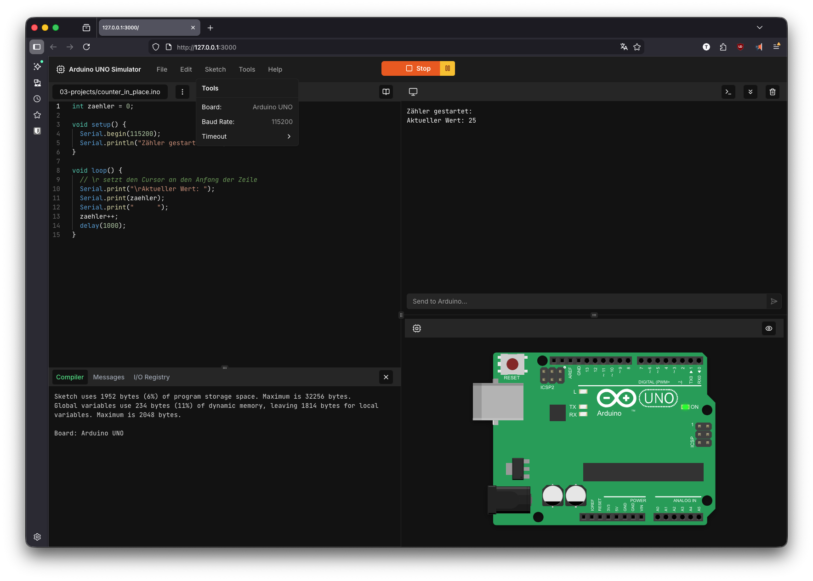
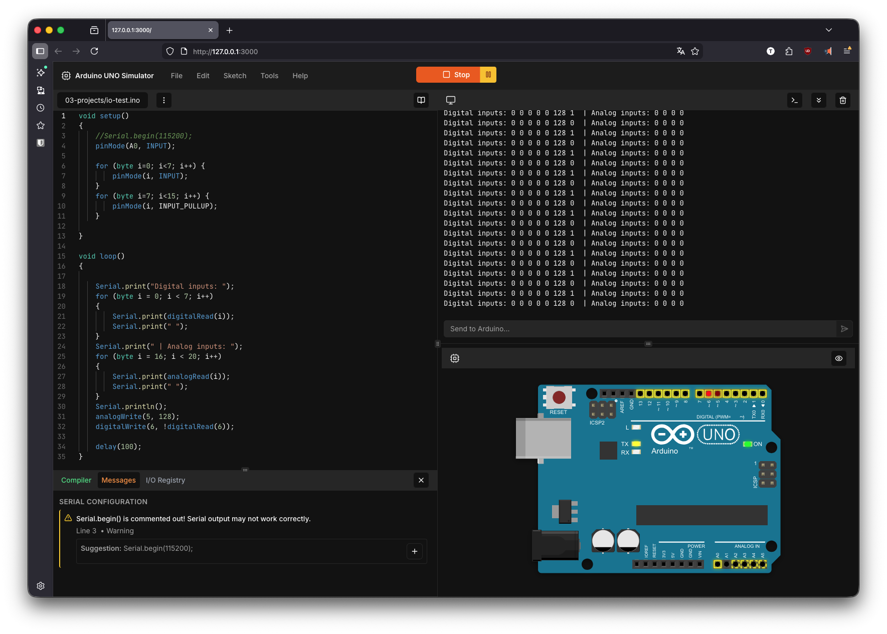
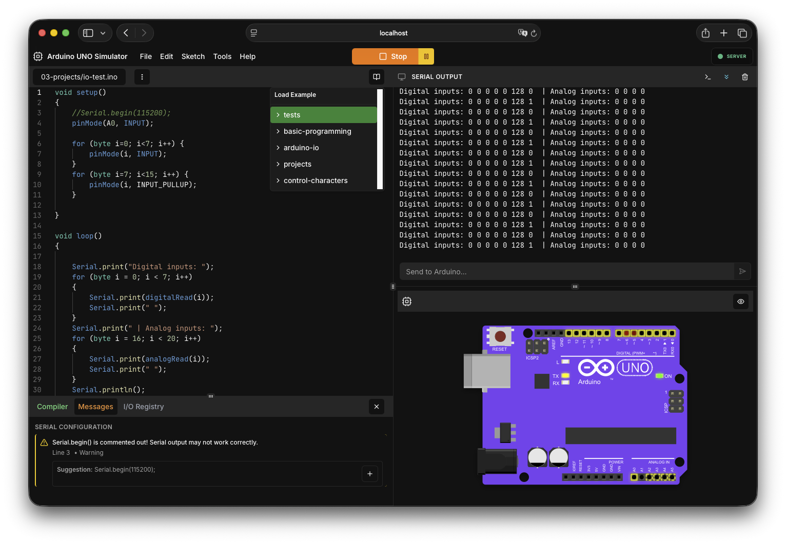

# UnoSim

[](https://github.com/MoDevIO/UnoSim)
[](https://github.com/MoDevIO/UnoSim/commits)
<br>
[](https://github.com/MoDevIO/UnoSim/actions/workflows/ci.yml)
[](https://modevio.github.io/UnoSim/)
<br>
[](https://github.com/MoDevIO/UnoSim/issues)
[](https://github.com/MoDevIO/UnoSim/pulls)

A web-based Arduino simulator with a browser UI, server-side Arduino compilation
and an interactive Arduino Preview for sketches.

## Start here

| You want to … | Read |
|---|---|
| use UnoSim in the browser (learners, teachers) | [docs/USER_GUIDE.md](docs/USER_GUIDE.md) (German) |
| try UnoSim in a classroom on one Ubuntu VM | [docs/INSTALL_UBUNTU_VBOX.md](docs/INSTALL_UBUNTU_VBOX.md) (German, tested end to end) |
| run UnoSim on a server behind your own reverse proxy | [docs/INSTALL_SERVER.md](docs/INSTALL_SERVER.md) (German) and [docs/SECURITY.md](docs/SECURITY.md) |
| develop UnoSim on your machine | [Development setup](#development-setup) below and [docs/INSTALL_LOCAL.md](docs/INSTALL_LOCAL.md) |
| write your own examples and Tutor content | [UnoSim-Examples README](https://github.com/ttbombadil/UnoSim-Examples#course-content-and-tutor-authoring) |
| find any other document | [docs/README.md](docs/README.md) |

## Preview

<p align="center">
   
   
</p>
<p align="center">
   
</p>

## Features

- **Code Editor**: Monaco editor integration for writing Arduino sketches with syntax highlighting
- **Compilation**: Compile Arduino code through the UnoSim backend
- **Browser emulation of the Arduino Uno**: the ATmega328P runs in your browser (avr8js in a Web Worker) and executes the machine code of the compiled sketch, so data types, overflow and timing behave like the board; the server only compiles. "Legacy" (File → Settings → Simulation engine) keeps the server-side simulation for the Uno
- **More boards (preview)**: Arduino Nano, Arduino Mega 2560 (four serial ports, A0–A15) and ATtiny85 (ATTinyCore, `Serial` as software UART) under Tools → Board, each with its own board view
- **Serial Monitor**: Real-time output display from the simulated Arduino
- **Pause/Resume Simulation**: Pause running sketches to inspect state, change pin values, and resume execution
- **Arduino Preview**: A preview of analog/digital inputs and outputs directly in the Arduino SVG
- **Web-based UI**: Use the simulator in a browser; local/server installation runs the backend
- **Modern UI**: Built with React and TailwindCSS for a responsive, professional interface
- **I/O Registry**: See which pins your program uses
- **Examples**: Load examples from a public GitHub repository; each browser can pick its own collection
- **Tutor**: Learning questions about the current sketch (experimental workspace). The Tutor currently works only with KI:connect.nrw and a personal KI:connect key; other providers are tracked in [#243](https://github.com/MoDevIO/UnoSim/issues/243)

## Tech Stack

- **Frontend**: React, TypeScript, Vite, TailwindCSS, Radix UI
- **Backend**: Node.js (TypeScript), Express, WebSocket support
- **Emulation**: avr8js (ATmega328P, ATmega2560, ATtiny85) in a Web Worker, packaged as the workspace package `@unosim/avr-emulator`
- **Editor**: Monaco Editor
- **Testing**: Vitest with React Testing Library
- **Build Tools**: Vite, esbuild

## Development setup

UnoSim runs on Linux and macOS. Production always runs in Docker; see
[docs/INSTALL_SERVER.md](docs/INSTALL_SERVER.md).

### Prerequisites

- Node.js 24.20.0 LTS (see `.nvmrc`) and npm
- [Arduino CLI](https://arduino.github.io/arduino-cli/) with the `arduino:avr` core, and ATTinyCore for the ATtiny85 (`sh scripts/install-attinycore.sh`, see [docs/INSTALL_LOCAL.md](docs/INSTALL_LOCAL.md))

Docker is not needed for development.

### Setup

```bash
git clone https://github.com/MoDevIO/UnoSim.git
cd UnoSim
npm ci
arduino-cli core update-index
arduino-cli core install arduino:avr
sh scripts/install-attinycore.sh   # optional: only for the ATtiny85
npm run provision:libraries        # project libraries of the catalog, checked by SHA-256
npm run dev:full
```

Open `http://localhost:3001`. `npm run dev:full` starts the backend
(`127.0.0.1:3000`) and the Vite dev server with hot reload; `npm run dev`
starts only the backend. The development profile is single-user, compiles
sketches directly on your machine, runs them in the browser emulation (the
"Legacy" host mock as a local process) and accepts only loopback requests.

Examples load from the public GitHub repository
`ttbombadil/unosim-examples` at `main` by default. Each browser can choose a
different repository under **File → Settings → External Examples** without
changing the server default; see
[`ssot_function_definition_ExternalExamples.md`](ssot/ssot_function_definition_ExternalExamples.md).

### Available Scripts

| Command | Description |
|---------|-------------|
| `npm run dev:full` | Start backend + client in development mode |
| `npm run dev` | Start backend only (no client) |
| `npm run dev:client` | Start Vite client only |
| `npm run build` | Build client, server, and worker for production |
| `npm run start` | Run the production build |
| `npm run check` | TypeScript type-check (`tsc --noEmit`) |
| `npm run test:fast` | Run deterministic unit tests |
| `npm run test:integration` | Run Arduino/toolchain integration tests |
| `npm run test:docker` | Run Docker sandbox integration tests, including the compile sandbox contract |
| `npm run build:sandbox` | Build the simulation sandbox and the compile sandbox image |
| `npm run emulate -- <hex> --board <id>` | Run a HEX file headless in the emulator and measure its speed |
| `npm run check:bundle` | Check the initial client bundle budget and that avr8js stays in the worker chunk |
| `npm run test:e2e` | Run Playwright browser tests |
| `npm run capacity:calibrate` | Measure host/Docker compile and simulation capacity and generate review-only Capacity recommendations |
| `npm run test:all` | Run unit, integration and Docker gates |
| `./run-tests.sh` | Full pipeline: lint, unit tests, Docker build, integration tests, E2E |
| `RUN_HEAVY_TESTS=1 ./run-tests.sh` | Full pipeline including the slow parallel-instance stress test |

For host-specific Capacity sizing, use `npm run capacity:calibrate` and follow
the review workflow in [`docs/CAPACITY_MODEL.md`](docs/CAPACITY_MODEL.md).
Calibration needs a built application (`npm run build`) and the sandbox image
and the compile sandbox (`npm run build:sandbox` builds both); it aborts early with a hint if the build is missing.

### Architecture Overview

The full picture is in [docs/ARCHITECTURE.md](docs/ARCHITECTURE.md).

- **Browser emulation** — The client runs the compiled flash image in a Web Worker (`packages/avr-emulator`, avr8js). `POST /api/compile` returns the image as `artifact`; the run itself needs no server and survives a lost connection.
- **Compile sandbox** — In the Docker profile every compile runs `arduino-cli` in its own short-lived container without network (`Dockerfile.compile-sandbox`).
- **Sandbox Runner Pool** — Manages runner leases for the host mock ("Legacy"). In the documented production path, each host-mock simulation runs in a short-lived isolated Docker sandbox with stdout/stderr capture for serial output and pin state reporting.
- **Compilation Worker Pool** — In production mode, the configured Node.js Worker Thread pool handles compilations in parallel via `CompilerWithFallback`. The Compose reference uses 8 workers (the pool runs at most 8); a full pool answers `503 SYSTEM_BUSY`. Current capacity guidance is in [`docs/CAPACITY_MODEL.md`](docs/CAPACITY_MODEL.md); [`docs/CAPACITY_HISTORICAL_PHASE_3_4.md`](docs/CAPACITY_HISTORICAL_PHASE_3_4.md) keeps the historical measurement.
- **WebSocket Layer** — Real-time communication between client and server for host-mock runs (serial output, pin state batches, simulation control) and status.
- **SonarQube Integration** — Optional SonarQube scans are wired into the pre-push hook and `./run-tests.sh` when `SONAR_TOKEN` and a reachable SonarQube service are available. Release blocking is controlled by `REQUIRE_RELEASE_GATE=1`.

## Notes for running tests (optional)

The repository contains a **robust, fast test pipeline**:

1. **Unit tests** (Vitest + React Testing Library) cover business logic and UI
   components. `npm run test:unit` is the deterministic refactoring gate;
   toolchain, Docker, browser and load tests are separate gates.
2. **E2E smoke flow** comprises three Playwright tests in
   `e2e/smoke-and-flow.spec.ts` for startup, compile/run with serial output, and
   dialogs. The repository also contains separate responsive, board, visual,
   and scalability E2E suites; run `npm run test:e2e` for the configured suite.
3. Heavy stress tests are opt-in. Use `RUN_HEAVY_TESTS=1 ./run-tests.sh` when
   validating Docker sandbox isolation and cleanup. Load-test commands are
   listed in [`docs/RELEASE_RUNBOOK.md`](docs/RELEASE_RUNBOOK.md) and capacity
   conclusions belong in [`docs/CAPACITY_MODEL.md`](docs/CAPACITY_MODEL.md).

Local quick‑check example:

```bash
npm run test:unit
```

For release gates, follow [`docs/RELEASE_RUNBOOK.md`](docs/RELEASE_RUNBOOK.md).
Testing conventions and timing budgets are maintained in
[`docs/TESTING_STANDARDS.md`](docs/TESTING_STANDARDS.md).

## License

MIT License - See [LICENSE](LICENSE) for details

This project uses third-party open-source dependencies under their respective
licenses. The browser emulation uses [avr8js](https://github.com/wokwi/avr8js)
(MIT). A compiled sketch contains code of the board's Arduino core: the
[Arduino AVR core](https://github.com/arduino/ArduinoCore-avr) or, for the
ATtiny85, [ATTinyCore](https://github.com/SpenceKonde/ATTinyCore) 1.5.2, both
LGPL 2.1. The compile sandbox image (`Dockerfile.compile-sandbox`) contains
both cores unmodified, as published (pinned in `scripts/arduino-avr-core-version`
and `scripts/attinycore-version`); UnoSim only adds a `platform.local.txt` that
turns off ATTinyCore's post-build hooks.

## Contact & Support

### Getting Help

- **Issues & Bugs**: Use the [GitHub Issues](https://github.com/modevio/UnoSim/issues) tracker
- **Feature Requests**: Open an [issue](https://github.com/modevio/UnoSim/issues) or a [pull request](https://github.com/modevio/UnoSim/pulls)
- **Questions**: Open a discussion or check existing issues

### Project Maintainers

- **Mo Tiltmann** (MoDevIO) - Couven-Gymnasium, Aachen
- **Tom Tiltmann** (ttbombadil) - Technische Hochschule, Köln

### Additional Resources

- [Arduino Official Documentation](https://www.arduino.cc/reference/)
- [Monaco Editor Documentation](https://microsoft.github.io/monaco-editor/)
- [React Documentation](https://react.dev/)
