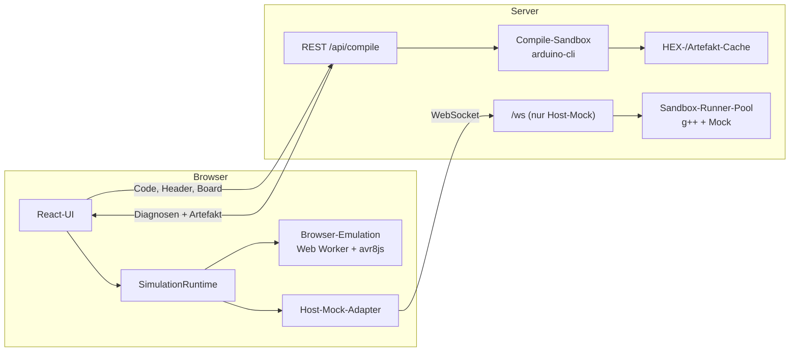
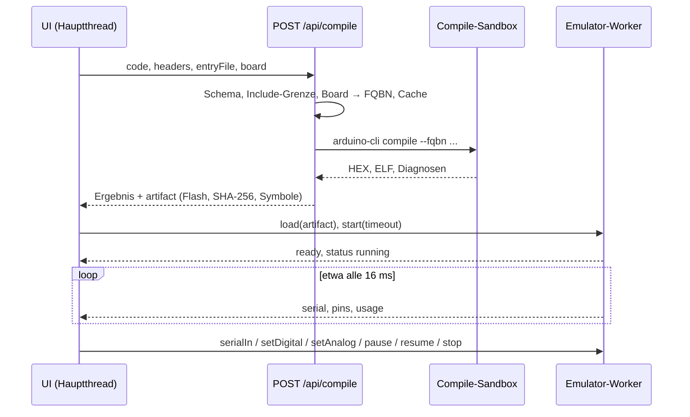
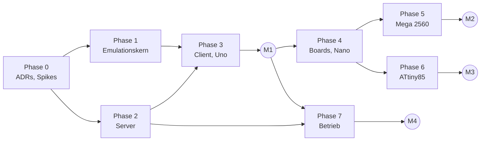
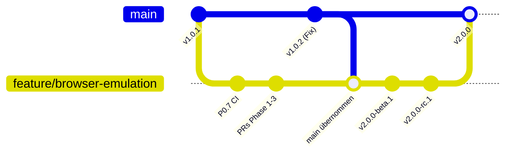

# Umsetzungsplan: Laufzeit in UnoSim austauschen

> **Nicht normativ.** Umsetzungsplan für Variante 1 („Laufzeit in UnoSim
> austauschen“) aus [browser-emulation.md](browser-emulation.md). Stand
> 2026-10-18, Basis `107208d92` (UnoSim `v1.0.1`). Verbindlich werden die
> Entscheidungen aus Abschnitt 3 erst mit den ADRs 0009 und 0010
> (Arbeitspaket P0.1). Nach Abschluss wird der Plan gelöscht, nicht archiviert
> ([Dokumentationsübersicht](../README.md)).

**Inhalt:**
0 Kurzfassung ·
1 Umfang ·
2 Ausgangslage ·
3 Entscheidungen ·
4 Zielarchitektur ·
5 Phasen und Arbeitspakete ·
6 Aufwand ·
7 Tests ·
8 Dokumentation ·
9 Rollout und Rückfall ·
10 Risiken ·
11 Offene Punkte ·
Anhang A Board-Steckbriefe ·
Anhang B Datei-Landkarte

## 0. Kurzfassung

UnoSim führt Sketches künftig als echtes AVR-Programm aus. Der Server
kompiliert wie heute mit `arduino-cli`, jetzt für das gewählte Board und im
Docker-Profil in einer Compile-Sandbox, und gibt das Flash-Abbild an den
Browser. Dort läuft es in einem Web Worker in avr8js. Die Oberfläche spricht
nur noch mit einer **Laufzeit-Schnittstelle**, hinter der zwei Backends stehen:

- **Browser-Emulation** (neu, Standard): avr8js im Web Worker, alle Boards.
- **Host-Mock** (bisheriger Weg über WebSocket, g++ und Docker-Sandbox):
  Rückfallebene, nur Uno.

Der Emulationskern wird ein eigenes Paket `@unosim/avr-emulator` mit
Board-Definitionen für **Uno, Nano, Mega 2560 und ATtiny85**. Alle vier Boards
stehen von Beginn an im Board-Katalog; ausgeprägt werden sie nacheinander.
Tutor, Course Content, Beispiel-Provider, Gateway, Kapazitätsmodell, Tests und
Betriebsdoku bleiben erhalten und werden angepasst.

Nicht Teil des Plans sind Verdrahtung und externe Bauteile sowie jede
Anbindung echter Hardware (Abschnitt 1.2).

| Meilenstein | Inhalt | Abnahme |
|---|---|---|
| M0 Entscheidungen | Spikes abgeschlossen, ADR 0009 und 0010 mit ihren Ergebnissen angenommen | Spike-Berichte erfüllen die Kriterien aus Phase 0 |
| M1 Uno im Browser | Browser-Emulation für den Uno, Standard im lokalen Profil | alle 51 Beispiele aus UnoSim-Examples `v3.0.0` stimmen mit Referenzen überein, die am echten Uno aufgenommen wurden (Ausnahmen ausgewiesen, Abschnitt 7.4); alle bisherigen Gates grün |
| M2 Nano und Mega | Board-Auswahl, Nano und Mega 2560 freigegeben | Proben, Korpus-Auszug und E2E je Board grün |
| M3 ATtiny85 | ATtiny85 mit serieller Ausgabe freigegeben | Proben und E2E grün |
| M4 Betrieb | Compile-Sandbox, Browser-Emulation Standard im Docker-Profil, Kapazitätsmodell und Betriebsdoku neu | Release-Gates aus dem [Release-Runbook](../RELEASE_RUNBOOK.md) einschließlich der neuen Gates |

M4 hängt nur von M1 und der Compile-Sandbox ab und kann parallel zu M2/M3
erreicht werden.

V2 entsteht im Integrationsbranch `feature/browser-emulation`; `main` bleibt
bis zur Abnahme bei V1 (v1.0.1 und Fehlerbehebungen). Vorabversionen
(`v2.0.0-beta.N`, `v2.0.0-rc.N`) werden im Unterricht erprobt, `v2.0.0` entsteht
nach dem Merge auf `main` (Abschnitt 9).

## 1. Umfang

### 1.1 Ziele

1. Sketches verhalten sich wie auf dem echten Board: Datentypgrößen, Überläufe,
   `sizeof`, Gleitkommaausgabe, Timeout von `Serial.parseInt()`, Folge von
   `random()`, Rechengeschwindigkeit, Speichergrenzen. Die Tabelle
   [Grenzen der Simulation](../USER_GUIDE.md#grenzen-der-simulation) schrumpft
   auf die Modellannahmen aus Abschnitt 4.8. Wo das Ergebnis von undefiniertem
   Verhalten abhängt (Überlauf vorzeichenbehafteter Typen), gilt die Aussage
   für den Code der gepinnten Toolchain, nicht allgemein für C++.
2. Im Standardweg läuft auf dem Server kein nativer Code von Studierenden mehr;
   die Laufzeit belastet den Server nicht.
3. Alles, was UnoSim heute während eines Laufs kann, bleibt erhalten: Serial
   Monitor und Plotter, serielle Eingabe, Pins am Board umschalten, analoge
   Schieberegler, Pin Monitor, I/O-Registry, Pause/Resume, Timeout, Reset,
   iframe-API, Telemetrie im Debug-Modus.
4. Vier Boards über einen Katalog, der weitere AVR-Boards ohne Umbau aufnimmt.
5. Der Host-Mock bleibt lauffähig, bis eine eigene Entscheidung ihn abbaut.

### 1.2 Nicht-Ziele

- **Anbindung von Hardware**, in beiden Bedeutungen:
  - keine Verdrahtung, kein Steckbrett und keine externen Bauteile (LED,
    Taster, LDR, Ultraschall, Displays, Servos) in der Simulation
    (Entscheidung 1 des Vorschlags: nein). Bibliotheken für Bauteile
    kompilieren weiter, haben aber keine Gegenstelle;
  - keine Verbindung zu echten Boards (Upload, WebSerial, Mitlesen).

  Die Bedienung bleibt wie heute: Pins am Board anklicken, analoge Eingänge
  per Schieberegler.
- Raspberry Pi Pico, ESP32 und Boards außerhalb des Katalogs.
- Debugger (Einzelschritt, Haltepunkte, Variablenansicht) und Zeilenzuordnung
  zur Laufzeit; die Registry zeigt für Laufzeitfunde weiter „runtime“.
- Variante 2 des Vorschlags (neues Projekt).
- Abbau des Host-Mocks; dafür gibt es nach M4 eine eigene Entscheidung
  (Abschnitt 9.4).

Die Referenzausgaben für die Tests werden einmalig von Hand an echten Boards
aufgenommen (Abschnitt 7.4). Das ist Testdatenpflege; UnoSim selbst bekommt
dadurch keine Hardware-Anbindung.

### 1.3 Begriffe

| Begriff | Bedeutung |
|---|---|
| Laufzeit-Backend | Teil, der einen kompilierten Sketch ausführt und Ereignisse an die UI liefert |
| Browser-Emulation | Laufzeit-Backend im Web Worker mit avr8js |
| Host-Mock | heutiges Laufzeit-Backend: g++-Build gegen den Arduino-Mock, lokal oder in der Docker-Sandbox |
| Artefakt | Flash-Abbild aus dem `arduino-cli`-Build mit Board, Prüfsumme und Symbolen |
| Board-Katalog | UnoSim-seitige Liste der Boards: FQBN, Core, Anzeigename, Backends, Freigabestatus |
| Board-Hardware, MCU-Profil | im Emulationspaket: Pinbelegung eines Boards bzw. Peripherie eines Mikrocontrollers |
| Proben | kurze Test-Sketches für ein Merkmal (z. B. `int-probe` aus Anhang B des Vorschlags) |
| Korpus | Proben plus die 51 Kursbeispiele mit Reizen und Referenzausgaben |
| Laufkennung (`runId`) | Nummer eines Laufs im Worker-Protokoll; Ereignisse mit fremder Nummer werden verworfen |
| Build-Identität | alle Eingaben, die das Kompilat bestimmen: Quelle, Board und Optionen, Toolchain, Cores, Bibliotheken, Buildoptionen |

## 2. Ausgangslage: Befunde, die den Plan bestimmen

| # | Befund | Beleg | Folge |
|---|---|---|---|
| B1 | Das HEX verlässt den Server bewusst nicht. `arduino-cli` läuft im Backend-Container ohne Sandbox; Inline-Assembler (`.incbin`, `.include`) kann jede Datei einbinden, die das Backend lesen darf. Mit ausgeliefertem Abbild wären das auch fremde Sketches in Temp- und Cache-Verzeichnissen. | [SECURITY.md](../SECURITY.md) „Compile boundary“, [compiler.routes.ts](../../server/routes/compiler.routes.ts) (`withoutBinary`), [OPEN_POINTS.md](../OPEN_POINTS.md) S1-ASM | Das Docker-Profil liefert Artefakte erst mit Compile-Sandbox aus (E6, P2.4). |
| B2 | Die Simulation kompiliert ein zweites Mal mit g++. | [prepare-phase.ts](../../server/services/sandbox/execution-phases/prepare-phase.ts) | Die Browser-Emulation startet mit dem Artefakt des REST-Compiles. |
| B3 | `fqbn` wird im Request angenommen, die Argument-Allowlist lässt aber nur `arduino:avr:uno` zu; die Compile-Ausgabe schreibt fest „Board: Arduino UNO“. | [schema.ts](../../shared/schema.ts), [process-executor.ts](../../server/services/process-executor.ts), [cli-runner.ts](../../server/services/compiler/cli-runner.ts) | Board-ID mit Katalog statt freier FQBN (P2.2). |
| B4 | Das Pin-Modell 0–19 (A0–A5 = 14–19) ist an vielen Stellen fest verdrahtet. | [input-limits.ts](../../shared/input-limits.ts) (`maxPin: 19`), [use-simulation-store.ts](../../client/src/hooks/use-simulation-store.ts), [arduino-board.tsx](../../client/src/components/features/arduino-board.tsx), [io-registry-parser.ts](../../shared/io-registry-parser.ts), [hardware-compatibility-parser.ts](../../shared/parsers/hardware-compatibility-parser.ts), [EXTERNAL_API.md](../EXTERNAL_API.md), [IoRegistry-SSOT](../../ssot/ssot_function_definition_IoRegistry.md) | Eigene Phase für die Board-Generalisierung (Phase 4). Uno bleibt Default, damit bestehende Tests unverändert gelten. |
| B5 | Der Client ersetzt während eines Laufs die statische Registry vollständig durch den Laufzeit-Snapshot; die IoRegistry-SSOT verlangt dagegen, dass sich beide ergänzen. Beim Host-Mock fällt das kaum auf, weil seine Instrumentierung Zeilen mitliefert. avr8js macht Lese- und Schreibzugriffe auf I/O-Register beobachtbar (`readHooks`, `writeHooks`; auch `IN`, `LDS`, `LD`, `SBIC`, `SBIS` lesen darüber). Ein Lesezugriff auf ein PIN-Register zeigt aber nur den Port, nicht Pin und Arduino-Funktion. | [io-registry-state.ts](../../client/src/lib/io-registry-state.ts), [arduino-registry-logic.ts](../../server/mocks/arduino-mock/arduino-registry-logic.ts), avr8js 0.21.1 `cpu/cpu`, `cpu/instruction` | Zusammenführung mit Herkunft statt Ersetzen (P3.7); Laufzeit-Erkennung über Registerzugriffe, ELF-Symbole nur zur Ergänzung (E7, P0.4, P1.9). |
| B6 | Pause friert den Prozess per `SIGSTOP` bzw. `docker pause` ein, `millis()` läuft weiter. Das Pausenbudget schützt Serverressourcen. | [PauseResume-SSOT](../../ssot/ssot_function_definition_PauseResume.md) 4.3 und 7.2 | Im Browser hält Pause die simulierte Zeit an; das Pausenbudget gilt nur noch für den Host-Mock. |
| B7 | Der Client steuert die Simulation ausschließlich über den WebSocket; Capabilities folgen aus der Erreichbarkeit des Backends. | [use-simulation-controller.ts](../../client/src/hooks/use-simulation-controller.ts), [useWebSocketHandler.ts](../../client/src/hooks/useWebSocketHandler.ts), [server-capabilities.ts](../../client/src/lib/server-capabilities.ts) | Laufzeit-Schnittstelle im Client (P3.1). Die Browser-Emulation erzeugt dieselben Nachrichtenformen wie der Server, damit die Auswertung bleibt. |
| B8 | `UNOSIM_SIMULATION_MODE` ist als entfernte Variable gesperrt. | [config.ts](../../server/config.ts) (`removedRuntimeVariables`) | Neue Variablen heißen `UNOSIM_RUNTIME_*` (Abschnitt 4.11). |
| B9 | Die CSP erlaubt Worker bereits (`worker-src 'self' blob:`). | [server/index.ts](../../server/index.ts) | Kein CSP-Umbau für den Web Worker. |
| B10 | avr8js 0.21 (aktuell 0.21.1 vom 2026-08-31) enthält Ports A–L, Timer 0–2 und USART0 des ATmega328P, ATtiny-Timer1, USI und einen ADC mit MUX5. Es fehlen Timer 3–5 und USART1–3 des ATmega2560, ein Analogkomparator und der interne Pull-up. Der zweite Parameter des CPU-Konstruktors ist nicht die SRAM-Größe des Chips: avr8js legt `sramBytes + 0x100` Byte Datenraum an (Standard 8192) und setzt SP beim Reset auf dessen letztes Byte. | Paketinhalt 0.21.0 und 0.21.1, Prototyp im Vorschlag (Anhang A) | Mega- und ATtiny-Profile schreibt UnoSim selbst (P5.1, P6.2), den Pull-up ergänzt das Pin-Modell (P1.4), das Speichermodell legt die Abbildung je MCU fest (4.3). |
| B11 | Bestehende Tests schreiben heutiges Verhalten fest: HEX bleibt auf dem Server, ein Verbindungsabbruch beendet den Lauf, Timing ±250 ms für den Mock. Tests ändern sich laut Agenten-Policy nur mit Begründung und Freigabe. | [compiler-binary-payload.test.ts](../../tests/server/routes/compiler-binary-payload.test.ts), [connection-loss.spec.ts](../../e2e/connection-loss.spec.ts), [ssot_agent_policy.md](../../ssot/ssot_agent_policy.md) 2.2 | Neue Tests ergänzen statt ersetzen; freigabepflichtige Änderungen stehen in Abschnitt 7.3. |
| B12 | Der HEX-Cache findet ein Kompilat über den Sketch-Hash aus Code, FQBN, Entry-File und Headern. Core-Version, `arduino-cli`-Version und Bibliotheken gehören nicht dazu; der Core-Fingerprint dient nur dem Core-Cache. `storage/` ist ein Bind-Mount und übersteht Deployments, nach einem Toolchain-Wechsel kommt also das alte Kompilat. Heute betrifft das nur die Größenausgabe, mit dem Artefakt das Laufzeitverhalten. | [compile-worker-utils.ts](../../server/services/workers/compile-worker-utils.ts) (`buildSketchHash`), [cache-manager.ts](../../server/services/compiler/cache-manager.ts) (`checkCacheHits`), [compile-worker.ts](../../server/services/workers/compile-worker.ts), [docker-compose.yml](../../docker-compose.yml) | Vollständige Build-Identität als Schlüssel und als geprüfte Metadaten (E15, P2.5). |

## 3. Entscheidungen

E1–E3 sind durch den Auftrag vorgegeben. Die übrigen sind Empfehlungen und
gehen mit P0.1 in ADR 0009 (Laufzeit) und ADR 0010 (Compile-Sandbox und
Artefakt). Die Spalte „Vorschlag“ verweist auf die offenen Entscheidungen in
Abschnitt 5 des Vorschlags.

| ID | Frage | Vorschlag | Entscheidung bzw. Empfehlung | Begründung |
|---|---|---|---|---|
| E1 | Schnitt | 3 | Variante 1: Laufzeit in UnoSim austauschen | vorgegeben |
| E2 | Verdrahtung, externe Bauteile | 1 | nein, und keine Anbindung echter Boards | vorgegeben |
| E3 | Boards | 2 | Uno (R3), Nano (ATmega328P), Mega 2560, ATtiny85; alle im Katalog ab P2.1, ausgeprägt in der Reihenfolge Uno → Nano → Mega → ATtiny85 | vorgegeben; ATtiny85 als verbreitetster ATtiny, weitere später über den Katalog |
| E4 | Paket | – | Emulationskern als npm-Paket `@unosim/avr-emulator` im Workspace `packages/avr-emulator/` des UnoSim-Repos. Ein eigenes Repo ist ein optionaler Folgeschritt (F1), der für keinen Meilenstein nötig ist | für den Betrieb reicht das Workspace-Paket; solange sich die Schnittstelle mit Mega und ATtiny noch ändert, gibt es keine Release-Reibung zwischen zwei Repos |
| E5 | Auslieferung | – | Artefakt als Feld `artifact` im Ergebnis von `POST /api/compile` (belegter Flash-Bereich Base64, Board, SHA-256, Symbole); kein eigener Abruf-Endpunkt | atomar mit dem Compile-Ergebnis, keine Verdrängung im HEX-Cache zwischen Compile und Abruf, keine neue Zugriffsregel; höchstens ~43 KB (Uno) bzw. ~350 KB (Mega) |
| E6 | Absicherung des Compiles | – | Docker-Profil: `arduino-cli` im kurzlebigen Compile-Container (Netz aus, Root-FS read-only, nur das eigene Projekt sichtbar). Ohne Compile-Sandbox liefert das Docker-Profil kein Artefakt aus (Startprüfung). Das lokale Profil kompiliert weiter direkt. | löst S1-ASM; das Abbild kann keine fremden Dateien enthalten |
| E7 | IO-Registry, Tutor-Fakten | 4 | Die Client-Registry führt statische Analyse und Laufzeitfunde zusammen und kennzeichnet die Herkunft jeder Angabe, statt die statische Registry während eines Laufs zu ersetzen (beide Backends). Laufzeitfunde stammen aus der Beobachtung der Registerzugriffe über `readHooks` und `writeHooks`; ELF-Symbole der I/O-Funktionen verfeinern die Zuordnung, sind aber keine Voraussetzung. Zeilen kommen nur aus der statischen Analyse. Tutor-Fakten bleiben statisch und bekommen das Board als Kontext. | Quelltextinformationen bleiben im Lauf sichtbar; die Registry hängt nicht davon ab, was LTO an Symbolen übrig lässt |
| E8 | Pause, Timeout, Limits | 5 | Der Worker setzt sie durch: Pause hält die simulierte Zeit an; Timeout bleibt Laufzeit nach Wanduhr ohne Pausen (1–300 s wie heute), ein Lauf mit Echtzeitfaktor unter 1 endet deshalb nach weniger simulierter Zeit (4.7); Pausenbudget, Simulations-Admission und Start-Rate-Limit nur noch für den Host-Mock | der Server hält für Browser-Läufe keine Ressource; die Bedienung bleibt gleich |
| E9 | Rückfallebene | – | Host-Mock bleibt für den Uno, wählbar über die angebotenen Backends (Server) und die Einstellung „Simulation engine“ (Nutzer). Standard: lokal ab M1, Docker ab M4 die Browser-Emulation | Rückweg bei Fehlern im Unterricht |
| E10 | Erster Meilenstein | 6 | wie vorgeschlagen: Die 51 Beispiele aus UnoSim-Examples `v3.0.0` stimmen mit Referenzen überein, die am echten Uno aufgenommen wurden. Ein Beispiel ohne solche Referenz weist die Abnahme aus; es zählt nicht als Hardwarevergleich (7.4) | messbar, deckt den Unterrichtsstoff ab, trennt Hardwarevergleich von Regression |
| E11 | ATtiny-Core | – | ATTinyCore (SpenceKonde), Version gepinnt, `chip=85`, 8 MHz intern. `Serial` ist dort eine Software-Schnittstelle, die der Emulator am TX-Pin dekodiert; serielle Eingabe erst nach Spike (Analogkomparator) | einziger verbreiteter Core mit `Serial` auf dem ATtiny85; Version, Lizenz und Pflegezustand prüft P0.5 |
| E12 | Echtzeit | – | Der Worker taktet auf Echtzeit. Ist das Gerät zu langsam, läuft die Simulation langsamer und zeigt den Echtzeitfaktor. Rückstand über 100 ms wird nicht aufgeholt: Der Bezug zur Wanduhr wird neu gesetzt, simuliert wird lückenlos weiter. Läuft der Worker voraus, wartet er. In verborgenen Tabs läuft er weiter (4.7) | `millis()` bleibt in sich stimmig, die UI bleibt bedienbar, kein Kern wird dauernd belegt |
| E13 | Board pro Sketch | – | Auswahl pro Browser und Arbeitsbereich (localStorage); Beispiele dürfen ein Board angeben (optional, Default `uno`) | entspricht der Arduino IDE; Course Content bleibt abwärtskompatibel |
| E14 | Verträge | – | WebSocket `1.0.0` bleibt (nur Host-Mock; neue Telemetriefelder optional). REST additiv `1.1.0` (`board`, `artifact`). iframe-API additiv `1.5.0` (Board, Pinbereich je Board). Worker-Protokoll neu und intern, versioniert im Paket | Clients brauchen keine Migration; die Produktversion steigt trotzdem auf 2.0.0 (E16) |
| E15 | Build-Identität | – | Schlüssel des Kompilat- und Artefakt-Caches und die beim Treffer geprüften Metadaten umfassen Quelle (Code, Header, Entry-File), Board mit vollständiger FQBN und Optionen, `arduino-cli`-Version, ID und Version aller beteiligten Cores, Bibliotheken mit Version, Buildoptionen und die Formatversion des Artefakts. Weicht eine Angabe ab, wird neu gebaut | ein Toolchain-Wechsel darf kein altes Kompilat ausliefern (B12) |
| E16 | Branches und Versionen | – | v1.0.1 bleibt Referenz für Unterricht, Vergleiche und Rückkehr. V2 entsteht in `feature/browser-emulation` über kleine PRs je Arbeitspaket; V1-Fehlerbehebungen erscheinen weiter über `main` (z. B. v1.0.2) und werden regelmäßig in den Integrationsbranch übernommen. Erprobung über `v2.0.0-beta.N` und `v2.0.0-rc.N`; nach Abnahme Merge auf `main` und Tag `v2.0.0` (Abschnitt 9) | neues Ausführungsmodell und sichtbare Verhaltensänderungen rechtfertigen eine Hauptversion, obwohl die Schnittstellen additiv bleiben; V1 bleibt bis zur Abnahme unberührt |

## 4. Zielarchitektur

### 4.1 Überblick



Der Server bleibt zuständig für Compile, Beispiele, Tutor, Gateway, Status und
den Host-Mock. Die Laufzeit der Browser-Emulation liegt vollständig im Browser.

### 4.2 Bausteine

| Baustein | Ort | Verantwortung |
|---|---|---|
| Emulationskern | `packages/avr-emulator/` (neu) | Abbild laden, MCU-Profile, Board-Hardware, Pin-, PWM-, ADC- und Serial-Modell, Laufzeit-IO-Erkennung, Taktung, Ereignisprotokoll, Worker-Host, Headless-Runner |
| Board-Katalog | `shared/boards.ts` (neu) | Board-IDs, Anzeigename, FQBN, Core-Version, Backends, Freigabestatus; Pin-Aliasse für die Parser aus der Board-Hardware |
| Artefakt-Schema | `shared/simulation-artifact.ts` (neu) | Form und Grenzen des Felds `artifact` |
| Compile-Sandbox | `Dockerfile.compile-sandbox`, `server/services/compiler/sandboxed-cli-runner.ts` (neu) | `arduino-cli` isoliert ausführen (Docker-Profil) |
| Artefakt-Bau | `server/services/compiler/artifact-builder.ts` (neu) | HEX → Flash, Symbole aus dem ELF, Cache-Sidecar |
| Laufzeit-Schnittstelle | `client/src/lib/runtime/` (neu) | `SimulationRuntime`, Auswahl, Browser-Backend, Host-Mock-Adapter |
| Board-Auswahl und -Darstellung | `use-board-selection.ts`, `board-view.tsx`, `client/public/boards/` (neu) | Auswahl, Persistenz, SVG je Board |
| Host-Mock | bestehend: Mock, SketchFileBuilder, SandboxRunner(-Pool), ExecutionManager, `simulation.ws.ts` | unverändert, nur Uno |

### 4.3 Board-Modell

Zwei Schichten: Das Paket beschreibt Hardware, UnoSim beschreibt das Produkt.
Das Paket importiert nichts aus UnoSim; `shared/` darf das Paket importieren.

```ts
// packages/avr-emulator/src/boards/types.ts (Skizze)
export type McuId = "atmega328p" | "atmega2560" | "attiny85";
export type BoardHardwareId = "uno" | "nano" | "mega2560" | "attiny85";

export interface McuProfile {
  readonly id: McuId;
  readonly flashBytes: number;
  readonly sramStart: number;      // erste SRAM-Adresse im Datenraum
  readonly sramBytes: number;      // SRAM laut Datenblatt
  readonly eepromBytes: number;
  /** Timer, Ports, USARTs, ADC, EEPROM und Watchdog für eine CPU. */
  createPeripherals(cpu: CPU, clockHz: number): McuPeripherals;
}
// RAMEND = sramStart + sramBytes - 1; der Datenraum umfasst 0 .. RAMEND.

export interface PinHardware {
  readonly pin: number;            // Arduino-Pinnummer des Cores (Uno: A0 = 14)
  readonly label: string;          // "D13", "A0", "PB3"
  readonly port?: { readonly port: string; readonly bit: number }; // fehlt bei A6/A7
  readonly adcChannel?: number;
  readonly pwm?: { readonly timer: number; readonly channel: "A" | "B" | "C" };
  readonly role?: "reset" | "serial";
}

export interface BoardHardware {
  readonly id: BoardHardwareId;
  readonly mcu: McuId;
  readonly clockHz: number;
  readonly vccVolts: number;       // Bezug der analogen Schieberegler
  readonly pins: readonly PinHardware[];
  readonly serialPorts: readonly SerialPortHardware[]; // USART n oder Software-UART
}
```

**Speichermodell.** Das Profil unterscheidet SRAM-Größe, SRAM-Startadresse und
Datenraum. avr8js kennt nur einen Parameter: `new CPU(progMem, sramBytes)`
legt `sramBytes + 0x100` Byte Datenraum an (Standard 8192) und setzt SP beim
Reset auf dessen letztes Byte. Das Profil übergibt deshalb
`RAMEND + 1 − 0x100` und nie den Standardwert; ein Profil ohne diese Angabe
ist ein Fehler.

| MCU | Register und I/O | SRAM | RAMEND | Parameter für avr8js |
|---|---|---|---|---|
| ATmega328P | 0x0000–0x00FF | 0x0100–0x08FF (2048 B) | 0x08FF | 2048 |
| ATmega2560 | 0x0000–0x01FF | 0x0200–0x21FF (8192 B) | 0x21FF | 8448 |
| ATtiny85 | 0x0000–0x005F | 0x0060–0x025F (512 B) | 0x025F | 352 |

Beim ATtiny85 beginnt der SRAM unter 0x100; avr8js behandelt den Datenraum
flach, P0.5 prüft, dass keine Peripherie Adressen ab 0x60 belegt. Für den Uno
prüft P1.3 die Konfiguration mit 2048 an SP nach dem Reset, an RAMEND aus Sicht
des Sketches und an einer Speicherprobe gegen den echten Uno.

```ts
// shared/boards.ts (Skizze)
export const BOARD_IDS = ["uno", "nano", "mega2560", "attiny85"] as const;
export type BoardId = (typeof BOARD_IDS)[number];
export type RuntimeKind = "browser" | "host-mock";

export interface BoardCatalogEntry {
  readonly id: BoardId;
  readonly displayName: string;    // "Arduino Uno"
  readonly fqbn: string;           // "arduino:avr:uno"
  readonly core: { readonly id: string; readonly version: string };
  readonly runtimes: readonly RuntimeKind[]; // Uno: ["browser", "host-mock"]
  readonly status: "planned" | "preview" | "available";
}
```

So sind die Boards „angelegt“: Alle vier stehen ab P2.1 mit Status `planned`
im Katalog, Typen und Tests kennen sie. Ein Board wird `preview` (wählbar mit
Hinweis), wenn seine Phase abgeschlossen ist, und `available` nach Review und
Unterrichtseinsatz.

### 4.4 Laufzeit-Schnittstelle im Client

```ts
// client/src/lib/runtime/simulation-runtime.ts (Skizze)
export type StartRequest =
  | { kind: "browser"; artifact: SimulationArtifact; timeoutSec: number }
  | { kind: "host-mock"; code: string; headers: SourceHeader[]; entryFile?: string; timeoutSec: number };

export interface SimulationRuntime {
  readonly kind: RuntimeKind;
  readonly features: RuntimeFeatures;    // serielle Eingabe, Pause, Boards ...
  start(request: StartRequest): void;
  pause(): void;
  resume(): void;
  stop(): void;
  reset(): void;                         // Browser: CPU-Reset ohne Neukompilieren
  sendSerial(text: string): void;
  setPin(pin: number, value: number): void; // digital 0/1, analog 0–1023
  /** Ereignisse in den Formen von ServerToClientWSMessage. */
  subscribe(listener: (event: RuntimeEvent) => void): () => void;
  dispose(): void;
}
```

Regeln:

- Ein Tab hat genau eine aktive Laufzeit; ein Wechsel ist nur im Zustand idle
  möglich.
- Ereignisse eines gestoppten, zurückgesetzten oder ersetzten Laufs erreichen
  die UI nicht (Laufkennung, 4.5).
- `RuntimeEvent` ist eine Teilmenge von `ServerToClientWSMessage`
  (`serial_output`, `simulation_status`, `pin_state_batch`, `io_registry`,
  `sim_telemetry`, `operation_error`, beim Host-Mock zusätzlich
  `compilation_status` und `compilation_error`). Die Auswertung in
  `useWebSocketHandler` bleibt und verarbeitet den Strom der aktiven Laufzeit.
- `holdsServerSimulation` wird laufzeitneutral (`holdsSimulationLifecycle`):
  Ein Tab hält höchstens einen Lauf, gleich bei welchem Backend.
- Die iframe-API und die Tastenkürzel laufen über dieselben Controller und
  bleiben dadurch für beide Backends gleich.

### 4.5 Ereignisprotokoll Worker ↔ UI

**Laufkennung.** Der Hauptthread vergibt eine aufsteigende `runId`. `load`,
`start` und `reset` beginnen eine neue `runId`, alle übrigen Befehle tragen die
aktuelle. Jedes Ereignis trägt die `runId`, zu der es gehört. Die UI verwirft
Ereignisse mit einer anderen als der aktuellen `runId`; verspätete Pins,
Serial-Texte oder Statusmeldungen eines gestoppten, zurückgesetzten oder
ersetzten Laufs erreichen den neuen Lauf so nicht. Das entspricht
`runGeneration` und `runAbort` im SandboxRunner des Host-Mocks.

Befehle von der UI an den Worker (alle mit `runId`):

| Befehl | Inhalt | Wirkung | Bestätigung |
|---|---|---|---|
| `load` | Flash als übertragener `ArrayBuffer`, Board, Build-Identität, Symbole | Maschine aufbauen, Reset; das Board des Artefakts muss zum gewählten Board passen | `ready` |
| `start` | `timeoutMs` | Lauf starten | `status running` |
| `pause`, `resume` | – | Takt anhalten bzw. fortsetzen | `status paused` bzw. `status running` |
| `stop` | – | Lauf beenden, Zustand verwerfen | `status stopped` |
| `reset` | – | CPU-Reset wie die RESET-Taste, der Lauf geht weiter | `status running` |
| `serialIn` | Port, Text | Bytes in die Empfangswarteschlange | – |
| `setDigital` | Pin, Pegel | Pin von außen treiben | – |
| `setAnalog` | Pin, Wert 0–1023 | Spannung am ADC-Kanal | – |

Ereignisse vom Worker an die UI (alle mit `runId`):

| Ereignis | Inhalt | Abbildung in UnoSim |
|---|---|---|
| `ready` | Protokollversion, Board | – |
| `heartbeat` | simulierte Zeit | nur Überwachung |
| `status` | `running`, `paused`, `stopped`, Grund | `simulation_status` und Systemzeile im Serial Monitor |
| `serial` | Port, Text (UTF-8) | `serial_output` (Port 0; weitere Ports ab P5.3) |
| `pins` | geänderte Pins seit dem letzten Bild (Modus, Pegel, PWM), Zähler | `pin_state_batch` |
| `usage` | Pin, Funktion, Modus | Laufzeitanteil von `io_registry` |
| `telemetry` | simulierte Zeit, Echtzeitfaktor, Pin- und Serial-Raten | `sim_telemetry` mit optionalen Feldern `simTimeMs`, `realTimeFactor` |
| `diagnostic` | die Fälle aus P1.10: Stack ragt in `.bss` oder Heap, PC außerhalb des Programms, Watchdog-Reset, `sleep` bei gesperrten Interrupts | Systemzeile im Serial Monitor, Debug-Konsole |
| `fault` | interner Fehler des Emulators | `operation_error` mit `SIMULATION_START_FAILED` bzw. `SIMULATION_FAULT` |

Der Worker sendet höchstens etwa 60 Pakete pro Sekunde: Pins zusammengefasst
auf den letzten Zustand je Pin, Serial als zusammenhängender Text, Telemetrie
einmal pro Sekunde. Eingehende Befehle prüft der Worker gegen das Schema.

**Zustandswechsel.** Die UI übernimmt `running` und `paused` erst mit der
Bestätigung zur aktuellen `runId`; bis dahin zeigt sie den Übergang wie heute
beim Warten auf den Server (`RUNNING_STARTING`). `stop` wirkt in der UI sofort:
Sie beendet die `runId` und verwirft alle späteren Ereignisse des Laufs. Auf
die Bestätigung wartet sie nur noch, um den Worker weiterverwenden zu dürfen.

**Ausfall des Workers.** Der Hauptthread überwacht den Worker selbst, denn ein
festhängender Worker kann kein `fault` mehr senden:

- `error` und `messageerror` am Worker gelten als Ausfall.
- Ein Worker mit geladener Maschine sendet etwa alle 500 ms `heartbeat`, auch
  in der Pause. Bleibt der Heartbeat länger als 3 s aus oder die Bestätigung
  eines Befehls länger als 2 s, gilt der Worker als ausgefallen.
- Bei einem Ausfall beendet der Hauptthread den Worker mit `terminate()`, setzt
  den Lauf auf `stopped`, schreibt eine Systemzeile, meldet `operation_error`
  mit `SIMULATION_FAULT` und erzeugt beim nächsten Start einen neuen Worker.
- Nachrichten, die danach noch ankommen, tragen eine veraltete `runId` und
  werden verworfen.
- Die Fristen gelten im sichtbaren Tab. Browser drosseln Timer in verborgenen
  Tabs; dort prüft der Hauptthread erst nach der Rückkehr, damit kein falscher
  Ausfall entsteht. P0.3 und P1.12 prüfen die Startwerte auf schwachen Geräten.

### 4.6 Ablauf Compile → Start



Bei einem Cache-Treffer mit passender Build-Identität (E15) entfällt der
Schritt zur Compile-Sandbox; das Artefakt kommt aus dem Cache-Sidecar. Im lokalen Profil kompiliert `arduino-cli`
direkt wie heute.

### 4.7 Zeit, Pause, Timeout

- Simulierte Zeit ist `cpu.cycles / clockHz`. `millis()`, `delay()`,
  Baudraten und ADC-Wandlungszeiten folgen daraus. Die Emulation ist
  lückenlos: Kein Zyklus, kein Timer-Ereignis, kein Interrupt und kein
  serielles Byte wird übersprungen.
- Bezug zur Wanduhr: Der Worker hält eine Wanduhr-Basis `wallBase` und die
  zugehörige simulierte Zeit `simBase`. Die Sollzeit ist
  `simBase + (jetzt − wallBase)`, Pausen nicht mitgerechnet.
- Hinterher: Der Worker rechnet in Scheiben von höchstens etwa 8 ms
  Rechenzeit, bis die Sollzeit erreicht ist, und gibt zwischen zwei Scheiben
  per `MessageChannel` ab, damit Befehle ankommen. Liegt er mehr als 100 ms
  hinter der Sollzeit, setzt er `wallBase` auf jetzt und `simBase` auf die
  aktuelle simulierte Zeit (E12). Das verschiebt nur den Bezug zur Wanduhr;
  simuliert wird weiter Zyklus für Zyklus. Der Echtzeitfaktor ist die
  simulierte Zeit je Wanduhrzeit über die letzten Sekunden.
- Voraus: Hat der Worker die Sollzeit erreicht, wartet er per `setTimeout`
  bis zum nächsten Termin (etwa 4 ms) und rechnet erst dann weiter. Ein sofort
  erneut eingeplantes `MessageChannel`-Signal ersetzt dieses Warten nicht: Es
  gäbe zwar die Ereignisschleife frei, hielte den Kern aber dauernd
  beschäftigt.
- Pause: keine Scheiben mehr, die simulierte Zeit steht; beim Fortsetzen wird
  der Bezug neu gesetzt. Pins dürfen in der Pause gesetzt werden und wirken
  beim Fortsetzen; serielle Eingabe bleibt in der Pause gesperrt
  (PauseResume-SSOT §10).
- Timeout: Laufzeit nach Wanduhr ohne Pausen, Bereich wie heute (E8). Folge:
  Bei Echtzeitfaktor 0,5 endet ein 30-Sekunden-Lauf nach etwa 15 simulierten
  Sekunden. Die Endemeldung nennt beide Zeiten; Benutzerhandbuch und ein Test
  (P1.8) halten das fest.
- Hintergrund-Tab (entschieden): Der Worker läuft weiter wie ein Board.
  Drosselt der Browser, sinkt der Echtzeitfaktor; der Timeout begrenzt die
  Last.
- Headless (Tests, Korpus): ohne Wanduhr, so schnell wie möglich bis zur
  Zielzeit; Reize nach simulierter Zeit.

### 4.8 Modellannahmen

Diese Tabelle ersetzt nach M1 die heutige Abweichungstabelle im
Benutzerhandbuch; die bisherige Tabelle gilt dann nur noch für „Legacy“.

| Thema | Modell |
|---|---|
| Offener Eingang (`INPUT`, nicht gesetzt) | liest LOW; am echten Board ist der Pegel undefiniert |
| `INPUT_PULLUP` | liest HIGH, bis der Nutzer LOW setzt |
| vom Nutzer gesetzter Pegel | gilt, bis der Sketch den Pin auf OUTPUT schaltet |
| analoger Eingang | Regler = Spannung 0 bis VCC in 1024 Stufen; mit Standardreferenz liefert `analogRead()` genau den Reglerwert |
| PWM | Tastverhältnis 0–255 aus Timer-Modus und Vergleichsregister, keine Signalform |
| Serial | Bytes am USART, Text als UTF-8; gesendeter Text endet wie heute mit Code 10; Empfangspuffer 64 Byte wie am Uno, nicht abgeholte Bytes gehen verloren |
| Zeit | exakt in simulierter Zeit; ist das Gerät zu langsam, laufen Uhr und Simulation langsamer als die Wanduhr (Echtzeitfaktor). Der Timeout zählt Wanduhrzeit (4.7) |
| Überlauf vorzeichenbehafteter Typen | in C++ undefiniertes Verhalten. UnoSim zeigt, was der Code der gepinnten Toolchain (avr-gcc aus `arduino:avr@1.8.8` mit den Optionen des Cores) auf dem Board tut, z. B. ergibt `32767 + 1` dort −32768. Das ist keine allgemeine C++-Garantie: Mit Optimierung kann derselbe Quelltext anders laufen, etwa eine Schleife mit Überlauf, auf dem echten Uno genauso |
| Pause | hält auch `millis()` an (heute läuft es weiter) |
| EEPROM | bleibt im Tab je Board erhalten; Neuladen der Seite leert es |
| I²C, SPI | Peripherie vorhanden, aber kein Gerät am Bus |
| Speicher | Größen und Adressen wie am Board (4.3). UnoSim meldet nur die Fälle aus P1.10, etwa einen Stack, der in `.bss` oder Heap hineinragt, wenn eine Prüfung ihn erfasst. Andere Speicherfehler bleiben wie am echten Board unbemerkt und zeigen sich nur in ihren Folgen |

### 4.9 I/O-Registry zur Laufzeit

**Zusammenführen statt Ersetzen.** Heute ersetzt `getEffectiveIoRegistry`
während eines Laufs die statische Registry vollständig durch den
Laufzeit-Snapshot (B5). Mit der Browser-Emulation verschwänden dadurch die
Zeilen, denn ihre Laufzeitfunde tragen keine. Neu gilt für beide Backends:

- Die statische Analyse (`analyzeStaticIO`) bleibt Hauptquelle; ihre Einträge
  und Zeilen bleiben während des Laufs sichtbar.
- Laufzeitfunde ergänzen je Pin und Funktion. Jede Angabe trägt ihre Herkunft
  (`static`, `runtime` oder beides), und die Registry-Tabelle macht sie
  sichtbar. Ein Fund ohne statische Zeile erscheint wie heute als „runtime“.
- Widersprechen sich beide Quellen, etwa statisch `INPUT` und zur Laufzeit
  `INPUT_PULLUP`, markiert die bestehende Konfliktlogik den Pin
  (IoRegistry-SSOT, Konflikt-Management).
- Beim Host-Mock tragen Laufzeitfunde weiter Zeilen aus der Instrumentierung.

**Erkennung im Emulator.** Grundlage ist die Beobachtung der Registerzugriffe.
avr8js leitet Lesezugriffe (`IN`, `LDS`, `LD`, `SBIC`, `SBIS`) über
`readHooks` und Schreibzugriffe über `writeHooks`; die eigenen Hooks rufen
vorhandene Hooks der Peripherie weiter auf und ändern keine Werte.

| Funktion | Beobachtung | Zuordnung ohne Symbole |
|---|---|---|
| `pinMode` | Schreiben auf DDR, für `INPUT_PULLUP` auch auf PORT | Pin über die geänderten Bits; ein Schreibzugriff ohne Bitänderung (etwa `INPUT` an einem Eingang) ist keinem Pin zuzuordnen |
| `digitalWrite` | Schreiben auf PORT eines Ausgangs | wie `pinMode` |
| `digitalRead` | Lesen des PIN-Registers | nur der Port, nicht der Pin |
| `analogRead` | ADMUX-Kanal beim Setzen von ADSC | Pin über den ADC-Kanal |
| `analogWrite` | COM-Bits und OCR des Timer-Kanals | Pin über den Timer-Kanal; die Werte 0 und 255 erscheinen als `digitalWrite` |

Direkte Registerzugriffe des Sketches (`PORTB |= …`) erscheinen auf demselben
Weg; die Herkunft weist sie als Laufzeitbeobachtung aus.

**Verfeinerung über Symbole.** Stehen die Einsprünge der fünf Funktionen im
ELF, markiert der Worker diese Adressen (Flag je Flash-Wort, O(1) je Befehl)
und liest beim Einsprung Pin (`r24`) und Wert bzw. Modus (`r22`) nach der
Aufrufkonvention von avr-gcc. Das ordnet auch `digitalRead` und Aufrufe ohne
Bitänderung einem Pin zu. Fehlen die Symbole, etwa weil LTO eine Funktion
eingebettet hat, bleibt die Registry vollständig nutzbar; nur diese
Verfeinerung entfällt. IoRegistry-SSOT-Testfall 8 (`digitalRead(p)` mit
berechnetem Pin) braucht die Symbole, sonst bleibt der Pin zur Laufzeit
unbekannt; die SSOT nennt diese Grenze.

Weitere Regeln:

- Ein `usage`-Ereignis entsteht nur beim ersten Auftreten je Pin und Funktion
  oder bei einem Moduswechsel (IoRegistry-SSOT, „Kein Spam“).
- Zeilennummern kommen nur aus der statischen Analyse; eine Zuordnung zur
  Laufzeit ist ein offener Punkt (Abschnitt 11).
- Die Grenze „höchstens 4 Registry-Zyklen pro Lauf“ ([SECURITY.md](../SECURITY.md))
  betrifft nur den Host-Mock; im Worker begrenzt die Zahl der Paare aus Pin
  und Funktion die Ereignisse.

### 4.10 Sicherheitsmodell

| Grenze | Heute | Neu |
|---|---|---|
| Compile | `arduino-cli` im Backend, Include-Grenze, HEX bleibt auf dem Server | Docker-Profil: `arduino-cli` in der Compile-Sandbox, Include-Grenze bleibt als zusätzliche Schicht; das Artefakt geht an den anfragenden Browser |
| Laufzeit | nativer Code in der Docker-Sandbox | AVR-Maschinencode im Emulator im Browser des Nutzers; auf dem Server nur noch beim Host-Mock |
| WebSocket | Pflicht für jede Simulation | nur Host-Mock |
| Last | Sandbox-Limits, Admission, Start-Rate-Limit | Compile-Limits und Compile-Rate-Limit; ein Browser-Lauf belastet nur den eigenen Tab |
| Ausgabe | Server begrenzt Zeilen und Bytes | Worker begrenzt die Paketrate, die UI das Zeilenlimit (5000); Serial-Text wird weiter nur als Text gerendert |

Weitere Regeln:

- Artefakte sind inhaltsadressiert über die Build-Identität (E15). Einen
  Cache-Treffer erhält nur, wer denselben Quelltext für dasselbe Board
  schickt; daraus lässt sich nichts Neues lernen.
- `artifact` steht nur in erfolgreichen Ergebnissen und nur, wenn die
  Startprüfung die Auslieferung erlaubt (lokales Profil oder Compile-Sandbox).
  Ein Feld `binary` gibt es weiterhin nicht.
- Der Worker interpretiert AVR-Maschinencode; ein Sketch kann kein JavaScript
  ausführen und den Worker nicht verlassen.
- Compile-Sandbox: Netz aus, Root-FS read-only, Projektdateien read-only,
  Build in einem begrenzten tmpfs, CPU-, Speicher-, PID- und Zeitgrenze,
  Ausgabegrenze 8 MiB wie heute, kein Docker-Socket, Owner-Label für die
  bestehende Aufräumroutine.

### 4.11 Konfiguration und Laufzeitprofile

| Variable | Werte | Standard | Bedeutung |
|---|---|---|---|
| `UNOSIM_RUNTIME_BACKENDS` | Liste aus `browser`, `host-mock` | lokal `browser,host-mock`; Docker `host-mock` bis M4, danach `browser,host-mock` | angebotene Backends; ohne `host-mock` startet kein Sandbox-Runner-Pool |
| `UNOSIM_DEFAULT_RUNTIME` | `browser` oder `host-mock` | lokal ab M1 `browser`; Docker ab M4 `browser` | Vorauswahl im Client |
| `UNOSIM_BOARDS` | Board-IDs | alle mit Status `preview` oder `available` | freigeschaltete Boards |
| `UNOSIM_DEFAULT_BOARD` | Board-ID | `uno` | ersetzt `ARDUINO_FQBN` |
| `COMPILE_SANDBOX_IMAGE` | Image | `unosim-compile-sandbox:latest` | nur Docker-Profil |
| `COMPILE_SANDBOX_MEMORY_MB`, `COMPILE_SANDBOX_CPU_LIMIT`, `COMPILE_SANDBOX_PIDS_LIMIT` | Zahlen | aus P0.2 | Ressourcen der Compile-Sandbox |

- `ARDUINO_FQBN` wird bis zur nächsten Major-Version als Alias angenommen,
  wenn der Wert einer Katalog-FQBN entspricht; danach Tombstone wie die
  Einträge in `removedRuntimeVariables`.
- Startprüfung im Docker-Profil: `browser` verlangt das Compile-Sandbox-Image,
  `host-mock` wie heute das Sandbox-Image. Fehlt eines, startet das Backend
  nicht.
- `GET /api/config` liefert Backends, Default, freigeschaltete Boards und die
  Protokollversion des Emulators.
- `/api/readiness` ist bereit, wenn alle konfigurierten Backends bereit sind.
- Simulationsparameter (`SIMULATION_*`, `SANDBOX_*`) gelten nur noch für den
  Host-Mock.

### 4.12 Kapazität

- Browser-Läufe kosten keine Server-CPU; die Grenze des Servers ist der
  Compile. Im Browser braucht ein Lauf laut Prototyp etwa ein Viertel Kern
  eines schnellen Geräts, auf schwachen Geräten mehr (P0.3).
- Neue Kenngrößen: Compiles pro Minute zu Stundenbeginn, parallele
  Compile-Container, Latenz p50/p95, Cache-Trefferquote (Klassen kompilieren
  oft unveränderte Beispiele).
- `npm run capacity:calibrate` bekommt ein Compile-Szenario mit Sandbox
  (P7.1). [ADR 0003](../adr/0003-scalability-and-ha-model.md) bleibt
  historisch; das neue Modell steht im
  [Kapazitätsmodell](../CAPACITY_MODEL.md).

## 5. Phasen und Arbeitspakete

Umfang je Paket: **S** bis 2 Personentage (PT), **M** 3–5 PT, **L** 6–10 PT,
**XL** über 10 PT. Der Umfang schließt Tests und die Doku des jeweiligen
Pakets ein. Jedes Paket kommt als eigener, prüfbarer PR in
`feature/browser-emulation` (größere Pakete in mehreren PRs) und endet mit
grünen Gates (`npm run check`,
`npm run lint`, `npm run test:unit`, `npm run check:docs`, bei Bedarf
`npm run test:integration`, `npm run test:docker`, `npm run test:e2e`).



Für M1 nötig sind aus Phase 2 nur P2.1, P2.2, P2.5, P2.6 und P2.7. P2.3
(ATTinyCore) braucht erst Phase 6, P2.4 (Compile-Sandbox) erst M4.

### Start und Arbeitsweise

1. PR #254 (CI für den Integrationsbranch) nach grüner CI nach `main` mergen.
2. Dokumentations-PR mit Vorschlag und diesem Plan nach `main` mergen.
3. `feature/browser-emulation` vom aktualisierten `main` anlegen und schützen
   (P0.7).
4. Mit einem kleinen Test-PR prüfen, dass die erforderlichen CI-Checks laufen.
5. Danach je Arbeitspaket eine neue Session mit eigenem Arbeitsbranch.

Für selbstständige Umsetzungs-Sessions liegt der vollständige Auftrag in
[browser-emulation-agent-prompt.md](browser-emulation-agent-prompt.md). Für eine
Session mit nur einem Paket genügt ein kurzer Startauftrag, zum Beispiel:

```text
Lies docs/proposals/browser-emulation-plan.md und die Repository-Regeln.
Setze ausschließlich P0.4 um. Verwende einen eigenen Arbeitsbranch auf Basis
von feature/browser-emulation. Dokumentiere Ergebnisse, Grenzen und die
Abnahmeevidenz.
```

Spike-Berichte liegen als nicht normative Dokumente unter `docs/proposals/`
und werden mit dem Plan gelöscht, sobald ihre Ergebnisse in den ADRs stehen.

### Phase 0 – Entscheidungen und Spikes (M0)

**P0.1 ADRs (M).**
ADR 0009 „Browser-Emulation als Laufzeit, Host-Mock als Rückfallebene“
(E1–E5, E7–E14, E16) und ADR 0010 „Compile-Sandbox und Auslieferung des
Flash-Abbilds“ (E6, E15) entstehen zuerst als Entwurf (Status `Proposed`).
Entscheidungen, deren Tragfähigkeit von einem Spike abhängt, bleiben bis zu
dessen Ergebnis offen und nehmen es auf:

| Entscheidung | hängt ab von |
|---|---|
| E6 Compile-Sandbox | P0.2 (Mehraufwand, Isolation) |
| E7 Laufzeit-Registry | P0.4 (Zuordnungsgenauigkeit) |
| E11 ATtiny-Core | P0.5 |
| E12 Echtzeit, Fristen der Überwachung | P0.3 |
| E3 Mega-Umfang | P0.6 |

Erst danach werden beide ADRs `Accepted`. Der Vorschlag verweist im Kopf auf
beide ADRs und diesen Plan. In [OPEN_POINTS.md](../OPEN_POINTS.md) wird S1-ASM
`OPEN` (entschieden, Umsetzung P2.4) und D5 auf den Host-Mock beschränkt,
sobald ADR 0010 angenommen ist.
*Abnahme:* Entwürfe zu Beginn von Phase 0; Annahme nach den Spikes mit
Verweis auf die Spike-Berichte; verlinkt aus docs/README und dem
Governance-Abschnitt in ARCHITECTURE.

**P0.2 Spike Compile-Sandbox (M).**
`docker run` mit `arduino-cli` 1.5.1 und den Cores, Netz aus, read-only,
Projekt read-only, Build im tmpfs. Messen: p50/p95 je Compile ohne Cache allein
und mit 8 bzw. 20 parallelen Compiles, verglichen mit heute; Strategie für den
Core-Cache (vorkompiliert im Image, read-only eingebunden oder in den tmpfs
kopiert). Angriffe: `.incbin` und `.include` auf `/etc/passwd`,
`/app/package.json` und ein fremdes Temp-Verzeichnis.
*Kriterium:* höchstens etwa 1 s Mehraufwand p95 gegenüber heute, keine fremde
Datei lesbar. Sonst einen Pool warmer Container mit Aufräumen je Auftrag
prüfen.

**P0.3 Spike Browser-Leistung (S).**
Den Prototyp aus Anhang A des Vorschlags im Web Worker auf drei
Referenzgeräten aus dem Unterricht laufen lassen (schwaches Schulgerät, Tablet,
aktuelles Notebook; Chrome, Firefox, Safari) mit `int-probe`, IT05.5 und
IT11.5. Messen: Echtzeitfaktor, CPU-Last, Reaktionszeit der UI.
*Kriterium:* Echtzeitfaktor mindestens 1,2 für IT05.5 auf dem schwächsten
Gerät; sonst die Gegenmaßnahmen aus Abschnitt 10 vor Phase 3 festlegen.

**P0.4 Spike Laufzeit-IO-Erkennung (M).**
Zuerst den Registerweg prüfen: eigene `readHooks` und `writeHooks` auf DDR,
PORT, PIN, ADMUX/ADCSRA und den Timer-Registern, verkettet mit den Hooks der
Peripherie. Für die 51 Beispiele und die IoRegistry-SSOT-Testfälle messen,
welcher Anteil der statisch bekannten Paare aus Pin und Funktion zur Laufzeit
bestätigt wird und welche Fälle nur portgenau oder gar nicht zuzuordnen sind.
Danach als Ergänzung: Stehen die fünf I/O-Funktionen nach dem LTO-Build als
Symbole mit Einsprung im ELF, und liefern `r24`/`r22` Pin und Wert?
*Ergebnis:* Tabelle der Zuordnungsgenauigkeit je Funktion mit und ohne
Symbole; Entscheidung, welche Laufzeitfunde die Registry zeigt. Die
Verfügbarkeit der Symbole ist keine Voraussetzung für die Registry.

**P0.5 Spike ATtiny85 (M).**
ATTinyCore per Board-Manager-URL in `arduino-cli` installieren, Version
pinnen, FQBN und Menüoptionen festlegen; Lizenz und Pflegezustand prüfen,
die Alternative damellis/attiny (ohne `Serial`) bewerten. In avr8js Port B,
Timer0, ATtinyTimer1 und ADC mit eigenen Konfigurationen betreiben, `millis()`
bei 8 MHz prüfen und `Serial.print` am TX-Pin dekodieren. Speichermodell nach
4.3: SRAM ab 0x60, avr8js-Parameter 352, keine Peripherie im Bereich ab 0x60.
*Ergebnis:* Core-Entscheidung, Pinbelegung, Umfang der seriellen Eingabe.

**P0.6 Spike Mega 2560 (S).**
HEX über 64 KB (Datensätze Typ 02/04), 22-Bit-PC, Datenraum bis `0x21FF`
(avr8js-Parameter 8448), Timer 3–5 und USART1–3 als eigene Konfigurationen;
Probe mit `Serial1` und PWM an 44–46.

**P0.7 Integrationsbranch und CI (S, vor dem ersten Arbeitspaket-PR).**
`feature/browser-emulation` von `main` @ v1.0.1 anlegen und wie `main` schützen
(nur PRs, erforderliche Checks). [ci.yml](../../.github/workflows/ci.yml) läuft
heute nur für Pushes und PRs gegen `main`; die Trigger `push` und
`pull_request` bekommen den Integrationsbranch dazu, damit jeder PR eines
Arbeitspakets dieselben Gates durchläuft wie später der Merge auf `main`. Die
Coverage-Veröffentlichung auf GitHub Pages bleibt auf `main` beschränkt (dort
schon per Bedingung). Agenten-Policy und Release-Runbook nennen den Weg
Arbeitsbranch → `feature/browser-emulation` → `main`.
*Abnahme:* Ein Test-PR gegen den Integrationsbranch löst alle CI-Jobs aus;
[ci-lint-contract.test.ts](../../tests/server/ci-lint-contract.test.ts) bleibt
grün bzw. wird nach 7.3 angepasst.

### Phase 1 – Emulationskern

**P1.1 Paketgerüst (M).**
`packages/avr-emulator/` mit eigenem `package.json` (`@unosim/avr-emulator`,
`private`, solange F1 nicht umgesetzt ist, MIT), avr8js exakt gepinnt (nach Review 0.21.1), keine
weiteren Laufzeitabhängigkeiten. Im Root: npm-Workspaces, TypeScript-Projekt,
Vitest-Projekt `unit-emulator` im Unit-Gate, ESLint-Grenze (das Paket
importiert nichts aus `client/`, `server/`, `shared/`), knip-Workspace,
Sonar-Quellen, Coverage-Guard. Der Builder im [Dockerfile](../../Dockerfile)
kopiert `packages/`.
*Abnahme:* `npm ci`, `npm run check`, `npm run lint`, `npm run test:unit`,
`npm run build` und der Docker-Build sind grün.

**P1.2 Simulations-Abbild (S).**
Intel-HEX-Parser (Datensätze 00, 01, 02, 04, Prüfsummen), Größenprüfung gegen
die MCU, SHA-256; ELF32-Leser für die Symboltabelle (I/O-Funktionen,
`__bss_end`, `__heap_start`) ohne externe Werkzeuge. Typ `SimulationImage` in
derselben Form wie das Feld `artifact`. Server (Artefakt-Bau) und
Headless-Runner nutzen denselben Code.

**P1.3 MCU-Profil ATmega328P, Boards Uno und Nano (M).**
CPU, Timer 0–2, USART0, Ports B/C/D, ADC mit 8 Kanälen, EEPROM, Watchdog und
Taktvorteiler aus avr8js zusammensetzen, SRAM-Parameter nach 4.3 (2048)
ausdrücklich setzen. Board-Hardware Uno (D0–D13, A0–A5 = 14–19) und Nano
(zusätzlich A6/A7 = 20/21, nur analog).
*Abnahme:* Pinbelegung gegen `pins_arduino.h` der gepinnten Core-Version
geprüft; SP nach dem Reset, RAMEND aus Sicht des Sketches und eine
Speicherprobe stimmen mit dem echten Uno überein.

**P1.4 Pin-Modell (M).**
Arduino-Pin ↔ Port/Bit; Modus aus DDR/PORT; Pegel; Pull-up-Ergänzung wie im
Prototyp; von außen getriebene Pins mit Vorrang, bis der Sketch auf OUTPUT
schaltet; Nur-Analog-Pins. Ausgabe als Änderungsliste je Bild (letzter Zustand
je Pin) plus Zähler für die Telemetrie.

**P1.5 PWM-Beobachtung (M).**
Je Timer-Kanal Compare-Output-Modus, Wellenform und OCR → Tastverhältnis
0–255 am zugehörigen Pin; Übergang zwischen PWM und digital (`analogWrite` mit
0 oder 255 schaltet digital).
*Abnahme:* Uno-Pins 3, 5, 6, 9, 10, 11 mit den Werten 0, 1, 25, 128, 254, 255.

**P1.6 ADC-Eingang (S).**
Reglerwert → Spannung `(Wert + 0,5) / 1024 · VCC`, damit `analogRead()` mit
Standardreferenz genau den Reglerwert liefert; INTERNAL und EXTERNAL nach
Datenblatt.

**P1.7 Serielle Schnittstelle (M).**
Senden: USART → UTF-8-Stromdekoder (mehrbytige Zeichen über Paketgrenzen
hinweg). Empfangen: Warteschlange mit einem Byte je Rahmenzeit, Empfangspuffer
des Cores wie am Board. Baudrate und Rahmen aus UBRR, U2X und UCSRC; der
Port-Index steht von Anfang an im Protokoll. Eingabegrenzen wie heute (4 KiB je
Nachricht, 1 MiB ausstehend).

**P1.8 Taktung und Lebenszyklus (L).**
Scheiben und Bezug zur Wanduhr nach 4.7 (Neusetzen bei Rückstand, Warten bei
Vorauslauf), Echtzeitfaktor, Pause/Resume, Stop, Reset (CPU und Peripherie),
Timeout nach E8, Headless-Modus mit Reizskript.
*Abnahme:* Tests mit künstlicher Uhr:
- `delay(587)` misst 586–587 ms wie am Uno; Pause hält `millis()` an;
- nach einem Rückstand stimmt der Zykluszähler mit der simulierten Zeit
  überein, und es fehlt weder ein Timer-Überlauf noch ein serielles Byte;
- ein vorauslaufender Worker wartet bis zum nächsten Termin, statt sofort
  weiterzurechnen;
- bei Echtzeitfaktor 0,5 endet ein 30-Sekunden-Lauf nach etwa 15 s
  simulierter Zeit, und die Endemeldung nennt beide Zeiten.

**P1.9 Laufzeit-IO-Erkennung (L).**
Nach 4.9 und dem Ergebnis von P0.4: Registerbeobachtung als Grundlage,
Einsprung-Haken über die Symboltabelle als Verfeinerung, Ereignis nur beim
ersten Auftreten, Herkunft je Fund.
*Abnahme:* Die Testfälle 1–11 der IoRegistry-SSOT liefern die erwarteten
Einträge; Fälle, die ohne Symbole nur portgenau sind, sind mit und ohne
Symbole getestet.

**P1.10 Diagnosen (S).**
Gemeldet werden als Ereignis `diagnostic`:
- Stack ragt in `.bss` oder Heap: SP unter `__bss_end` bzw. `__brkval` (falls
  `malloc` gelinkt ist). Geprüft wird am Ende jeder Scheibe und bei
  Schreibzugriffen auf SPL/SPH. `PUSH`, `CALL` und Interrupts ändern SP in
  avr8js direkt, ohne Hook; ein Überlauf, der vor der nächsten Prüfung
  zurückgeht, bleibt unerkannt.
- PC außerhalb des Programms (gelöschter Flash).
- Watchdog-Reset.
- `sleep` bei gesperrten Interrupts.

Nicht erkannt werden Schreibzugriffe über Arraygrenzen, Zugriffe auf
freigegebenen Speicher, Heap-Fragmentierung und Zeiger, die in I/O-Register
schreiben; sie wirken wie am echten Board. Ohne die Symbole `__bss_end` und
`__brkval` entfällt die Stack-Prüfung. Benutzerhandbuch und
SimulationRuntime-SSOT nennen genau diese Liste.

**P1.11 Ereignisprotokoll und Bündelung (M).**
Befehle und Ereignisse aus 4.5 als versionierte Typen mit `runId`,
Bestätigungen und `heartbeat`; Prüfung eingehender Befehle; Bündelung auf etwa
60 Pakete pro Sekunde, Telemetrie einmal pro Sekunde, Grenzen gegen
Überlastung der UI.

**P1.12 Worker-Host (M).**
Einstieg `@unosim/avr-emulator/worker`: Befehle mit `runId` annehmen, Flash
als übertragenen Puffer übernehmen, Board und Build-Identität des Artefakts
gegen das gewählte Board prüfen, Bestätigungen und `heartbeat` senden,
interne Fehler als `fault` melden. Der Worker bleibt zwischen Läufen bestehen.
Die Überwachung von außen (Fristen, `terminate()`, Neuerzeugung) liegt im
Hauptthread (P3.2), weil ein festhängender Worker sie nicht selbst leisten
kann.

**P1.13 Headless-Runner und Werkzeug (S).**
`runHeadless(image, { simMs, events })` für Tests und Korpus; ein kleines CLI
für Maintainer ersetzt das Prototyp-Skript; Leistungsmessung als Bericht.

**P1.14 Referenzkorpus (L, parallel bis M1).**
Format, Klassen und Ablage nach Abschnitt 7.4; Proben für Datentypen,
Überläufe, Gleitkomma, `parseInt`, `random`, `millis`/`delay`, PWM, ADC,
Pull-up und Speicher; die 51 Beispiele mit Reizskripten und
Zustandsprüfungen; Referenzen der Klasse `hardware`, einmalig am echten Uno
aufgenommen.

### Phase 2 – Server

**P2.1 Board-Katalog (M).**
`shared/boards.ts` mit allen vier Boards (Uno `available` ab M1, übrige
`planned`), zod-Schema `boardIdSchema`, Pin-Aliasse für die Parser aus der
Board-Hardware des Pakets. `getClientConfig()` liefert Boards und Backends
(4.11). Neue SSOT `ssot_function_definition_Boards.md`.
*Abnahme:* Konsistenztest: jede Board-ID hat Hardware im Paket und eine FQBN
in der Allowlist.

**P2.2 Board im Compile-Request (M).**
`compileRequestSchema` erhält `board` (optional, Default aus der
Konfiguration); `fqbn` ist veraltet und nur noch erlaubt, wenn er zur Board-FQBN
passt. Die FQBN-Allowlist in
[process-executor.ts](../../server/services/process-executor.ts) entsteht aus
dem Katalog. Die Compile-Ausgabe nennt den Boardnamen aus dem Katalog. Den
Cache-Schlüssel erweitert P2.5 zur vollständigen Build-Identität (E15).
[worker-protocol.ts](../../shared/worker-protocol.ts) und der
Compile-Worker reichen Board und Artefakt durch. `CodeParser` erhält das Board
(Grundlage für Phase 4).

**P2.3 Toolchain für alle Boards (M).**
`arduino:avr@1.8.8` deckt Uno, Nano und Mega. ATTinyCore bekommt eine eigene
Versionsdatei, ein Installations- und ein Prüfskript nach dem Muster von
`scripts/arduino-avr-core-version` und `scripts/install-arduino-avr-core.sh`,
die Board-Manager-URL kommt in die `arduino-cli`-Konfiguration. Anpassen:
Dockerfile, CI-Cache-Schlüssel, `scripts/install-ubuntu-vbox.sh`,
INSTALL_LOCAL. Der Core-Fingerprint stützt sich auf die gepinnten
Versionsdateien und geht in die Build-Identität ein (E15). Vorkompilierte
Core-Caches je FQBN halten den ersten Compile kurz.

**P2.4 Compile-Sandbox (L, Voraussetzung für M4).**
Image `Dockerfile.compile-sandbox` (`arduino-cli` 1.5.1, gepinnte Cores,
Core-Caches) und Skript `build:compile-sandbox` analog zu `build:sandbox`.
`sandboxed-cli-runner.ts` mit derselben Schnittstelle wie
`compileWithArduinoCli`; Docker-Aufruf über den bestehenden
DockerCommandBuilder; Grenzen aus 4.10; Owner-Label und Aufräumen über
`orphan-sweep.ts`; Diagnosepfade der Sandbox bereinigen; Argument-Allowlist
für die Compile-Container erweitern. Auswahl: Docker-Profil → Sandbox, lokales
Profil → direkt. Parallelität über die bestehenden Compile-Grenzen
(Worker-Pool, Gatekeeper, `COMPILE_MAX_CONCURRENT`). Startprüfung und
Readiness nach 4.11; `check-leaks.sh` prüft auch Compile-Container. Danach
`arduino-cli` aus dem Backend-Image entfernen.
*Abnahme:* Sandbox-Vertragstest im Docker-Gate (Abschnitt 7.8).

**P2.5 Artefakt und Build-Identität (L).**
- Build-Identität nach E15 als eigener Typ. Die Schlüssel des HEX-Caches, des
  Artefakt-Sidecars und des In-Memory-Ergebniscaches der Route entstehen
  daraus; `buildSketchHash` und der Core-Fingerprint gehen darin auf.
  Compile-Worker und direkter Compiler nutzen weiter dieselbe Identität.
- `artifact-builder.ts` liest HEX und ELF aus dem Build-Verzeichnis und baut
  das Artefakt (P1.2) mit der Build-Identität in den Metadaten. Ein Sidecar
  `<schlüssel>.artifact.json` liegt im HEX-Cache. Bei einem Treffer werden die
  Metadaten gegen die aktuelle Identität geprüft; weichen sie ab oder fehlt der
  Sidecar, wird neu gebaut.
- Die Route gibt `artifact` nur bei Erfolg und nur bei erlaubter Auslieferung
  aus; der In-Memory-Ergebniscache hält das Artefakt nicht doppelt. Schema in
  `shared/simulation-artifact.ts`, REST-Version `1.1.0`.

*Abnahme:* Tests zeigen, dass bei gleicher Quelle eine geänderte Core-,
`arduino-cli`- oder Bibliotheksversion oder eine geänderte Boardoption einen
Neubau auslöst und dass ein unveränderter Build weiter aus dem Cache kommt.

**P2.6 Laufzeit-Backends im Server (M).**
Variablen und Startprüfungen nach 4.11; Runner-Pool nur bei Host-Mock;
`start_simulation` ohne Host-Mock → `operation_error` mit `RUNTIME_UNAVAILABLE`;
Status und Readiness nach Backends.

**P2.7 Board-Kontext für den Tutor (S).**
Die Tutor-Anfrage trägt die Board-ID; die anwendungseigene Systemvorgabe nennt
Board und Datentypgrößen (Repository-Inhalte steuern das nicht, ADR 0006).
`npm run test:tutor-quality` bleibt grün.

### Phase 3 – Client für den Uno (M1)

**P3.1 Laufzeit-Schnittstelle und Auswahl (M).**
`client/src/lib/runtime/simulation-runtime.ts`, `runtime-selection.ts`, Hook
`use-simulation-runtime.ts`. Auswahlregel: vom Server angeboten, vom Board
unterstützt, sonst Nutzerwahl, sonst Server-Default. Einstellung unter
**File → Settings**: „Simulation engine“ mit „Emulation“ und „Legacy“ (die
Oberfläche bleibt englisch).

**P3.2 Browser-Backend (M).**
`browser-runtime.ts` startet den Worker
(`new Worker(new URL(...), { type: "module" })`), überträgt das Artefakt,
setzt Worker-Ereignisse in `RuntimeEvent` um und erzeugt die Systemzeilen
(„--- Simulation paused ---“ usw.) so, wie sie heute der Server sendet. Es
überwacht den Worker nach 4.5: verwirft Ereignisse fremder `runId`, übernimmt
Zustände erst mit der Bestätigung, behandelt `error` und `messageerror` und
beendet einen Worker ohne `heartbeat` oder Bestätigung mit `terminate()`.

**P3.3 Host-Mock-Adapter (S).**
Kapselt `websocket-manager` und die bestehenden Nachrichten ohne
Verhaltensänderung; alle bestehenden Tests bleiben grün.

**P3.4 Controller umstellen (L).**
- [use-compile-and-run.ts](../../client/src/hooks/use-compile-and-run.ts):
  Artefakt aus dem Compile-Ergebnis neben Code und Headern halten, Start über
  die Laufzeit; Reset im Browser als CPU-Reset ohne Neukompilieren, wenn Code
  und Board unverändert sind.
- [use-simulation-controller.ts](../../client/src/hooks/use-simulation-controller.ts):
  Laufzeitmethoden statt `sendMessage`; `ensureBackendConnected` nur noch für
  Compile und Host-Mock.
- [useWebSocketHandler.ts](../../client/src/hooks/useWebSocketHandler.ts):
  verarbeitet den Ereignisstrom der aktiven Laufzeit (Umbenennung in einem
  Folgeschritt).
- `use-simulation-lifecycle.ts`, `useSimulatorExternalControl.ts`,
  `use-external-api.ts`, `server-capabilities.ts` (`canSimulate` je Backend),
  `arduino.types.ts` (`holdsSimulationLifecycle`), ViewModels `simulation` und
  `connection` in `useArduinoSimulatorPage`.

**P3.5 Verbindungsverhalten (S).**
Ein Browser-Lauf läuft bei Verbindungsverlust weiter; Compile, Beispiele und
Tutor zeigen den Verbindungszustand wie heute; die Reconnect-Warteschlange
gilt nur für den Host-Mock.

**P3.6 Anzeigen (M).**
Kopfzeile und Debug-Leiste zeigen bei Browser-Läufen Backend und
Echtzeitfaktor statt Runner-Index; Telemetrie mit `simTimeMs` und
`realTimeFactor`; Diagnosen als Systemzeilen.

**P3.7 I/O-Registry zusammenführen (M).**
`getEffectiveIoRegistry` in
[io-registry-state.ts](../../client/src/lib/io-registry-state.ts) wird durch
eine Zusammenführung nach 4.9 ersetzt: Statische Einträge und Zeilen bleiben,
Laufzeitfunde aus `usage`-Ereignissen bzw. dem Host-Mock ergänzen je Pin und
Funktion, jede Angabe trägt ihre Herkunft. `IOPinRecord` in
[schema.ts](../../shared/schema.ts) bekommt dafür optionale Felder; die
Registry-Tabelle in `parser-output.tsx` zeigt die Herkunft; die Konfliktlogik
bewertet beide Quellen. Gilt für beide Backends. Die IoRegistry-SSOT ändert
sich im selben Paket;
[io-registry-precedence.test.ts](../../tests/client/hooks/io-registry-precedence.test.ts)
schreibt den bisherigen Vorrang fest und steht in 7.3.

**P3.8 Test-Hooks (S).**
DEV-Hook `__SET_LAST_COMPILED_ARTIFACT__` neben `__SET_LAST_COMPILED_CODE__`;
Laufzeit für E2E per localStorage-Schlüssel vorwählbar.

**P3.9 Bundle (S).**
Der Emulator liegt nur im Worker-Chunk. `scripts/check-bundle-budget.mjs`
prüft, dass avr8js nicht im initialen Ladepfad liegt; Grenzwerte ändern sich
nur mit Begründung.

**P3.10 Abnahme M1 (M).**
Korpus grün; für die 51 Beispiele liegen Referenzen der Klasse `hardware` vor,
Ausnahmen sind in der Abnahme ausgewiesen (7.4). E2E der Browser-Emulation
grün, alle bestehenden Gates grün, Benutzerhandbuch „Grenzen der Simulation“
neu, Standard im lokalen Profil `browser`.

### Phase 4 – Board-Generalisierung und Nano

**P4.1 Pin-Modell in `shared/` (M).**
Pinlisten, Labels und Fähigkeiten aus dem Katalog; Pinprüfung je Board; die
WebSocket-Grenze `maxPin: 19` bleibt für den Host-Mock;
`shared/utils/arduino-utils.ts`.

**P4.2 Parser (L).**
`io-registry-parser.ts`: Aliasse (A0…An, `LED_BUILTIN`) und Pinbereich je
Board. `hardware-compatibility-parser.ts`: PWM-Pins, Nur-Analog-Pins.
`pin-conflicts-parser.ts`: serielle Pins je Board.
`serial-configuration-parser.ts`: `Serial1`–`Serial3` (Mega), kein
Hardware-Serial (ATtiny85). Für den Uno bleiben alle Ergebnisse gleich; die
bestehenden Tests sind die Regression.

**P4.3 Client-Zustand (M).**
`use-simulation-store.ts` (`getPinType`), `use-pin-state.ts`,
`usePinPollingEngine.ts`, `pin-monitor.tsx`, `parser-output.tsx` und die
Registry-Tabelle mit Zeilen je Board.

**P4.4 Board-Darstellung (L).**
`board-view.tsx` als Rahmen; das Uno-SVG bleibt unverändert, damit die
visuellen Snapshots stabil bleiben. Neue SVGs je Board mit derselben
id-Konvention (`pin-<n>-click`, `pin-<n>-state`, `pin-<n>-frame`, analog
`pin-A<k>-…`), Board-Farbe, Mobile-Layout. Grafiken selbst zeichnen oder aus
MIT-lizenzierten Quellen mit Lizenzhinweis übernehmen; keine fremden
Markennamen in der UI.

**P4.5 Board-Auswahl (M).**
Menü **Tools → Board**; Persistenz im localStorage (Zugriffe abgesichert); ein
Wechsel stoppt den Lauf und verwirft das Artefakt; Compile mit `board`. Boards
mit Status `planned` sind nicht wählbar, `preview` nur mit Hinweis.

**P4.6 Beispiele mit Board (M, repoübergreifend).**
`server/services/examples/examples-schema.ts`: optionales `board`,
abwärtskompatibel. Lädt jemand ein Beispiel für ein anderes Board, fragt
UnoSim nach. README von UnoSim-Examples, SSOTs ExternalExamples und
CourseContent.

**P4.7 iframe-API `1.5.0` (S).**
`GET_STATE` liefert Board und Backend; `SET_PIN_STATE` prüft den Pinbereich je
Board; [EXTERNAL_API.md](../EXTERNAL_API.md).

**P4.8 Nano freigeben (S).**
Board-Hardware aus P1.3, SVG, Proben für A6/A7, E2E-Smoke; Status `preview`.

### Phase 5 – Mega 2560 (M2)

**P5.1 MCU-Profil ATmega2560 (L).**
Ports A–L, Timer 0–5, USART0–3, ADC mit 16 Kanälen (MUX5), Datenraum bis
`0x21FF`, 22-Bit-PC, Interrupt-Vektoren. Nach P0.6 sind alles Konfigurationen
der vorhandenen avr8js-Klassen, aber für **alle** Peripherien mit den
Mega-Vektoren (die mitgelieferten Konfigurationen tragen die des 328P),
dazu die Interrupt-Verdrahtung der Ports (INT0–7, PCINT0–2) und die
MUX5-Kanalbelegung ([Spike P0.6](spike-p0-6-mega2560.md)).

**P5.2 Board-Hardware Mega (M).**
Pins 0–69 (A0–A15 = 54–69), PWM 2–13 und 44–46, serielle Pins, LED an 13.

**P5.3 Mehrere serielle Schnittstellen (M).**
Serial Monitor mit Portauswahl (Serial, Serial1–3), Eingabe an den gewählten
Port, Plotter für Port 0. SerialOutput-SSOT ergänzen.

**P5.4 Mega freigeben (M).**
SVG, Parserregeln, Proben, E2E, Leistung mit 256-KB-Flash; Status `preview`.

### Phase 6 – ATtiny85 (M3)

**P6.1 Toolchain (S).** ATTinyCore aus P2.3 im Compile-Sandbox-Image und,
solange P2.4 nicht abgeschlossen ist, im Backend-Image.

**P6.2 MCU-Profil ATtiny85 (L).**
Port B, Timer0 mit eigener Konfiguration, ATtinyTimer1, ADC (ADC0–3 an PB5,
PB2, PB4, PB3; Referenzen VCC, 1,1 V, 2,56 V), Watchdog, Ein-Wort-Vektoren,
8 MHz; kein USART.

**P6.3 Software-UART (M).**
TX-Pin des Cores dekodieren, Baudrate aus der Bitbreite. Serielle Eingabe nur,
wenn P0.5 sie für machbar hält (Analogkomparator); sonst ist das Eingabefeld
für dieses Board aus und das Benutzerhandbuch nennt den Grund.

**P6.4 Board-Hardware und Regeln (M).**
Pins 0–5, PB5 als RESET sichtbar, aber nicht nutzbar; A0–A3; PWM 0, 1, 4;
Parserregeln (kein Hardware-Serial, Warnung bei Nutzung des TX-Pins).

**P6.5 ATtiny85 freigeben (M).**
SVG (DIP-8), Proben, E2E; Status `preview`.

### Phase 7 – Betrieb, Kapazität, Release (M4)

**P7.1 Kapazität (M).**
Compile-Szenario mit Sandbox in `scripts/calibrate-capacity.ts` und den
Kapazitätsskripten; Messung auf dem Referenz-Host; Kapazitätsmodell neu.

**P7.2 Deployment (M).**
`docker-compose.yml` (Image-Variable, Build), Installer, Deployment-Tests
(`npm run test:deployment`, `npm run test:deployment:installer`),
INSTALL_SERVER, INSTALL_UBUNTU_VBOX, Release-Runbook.

**P7.3 Vorabversionen und Erprobung im Unterricht (M).**
Tags `v2.0.0-beta.N` und `v2.0.0-rc.N` im Integrationsbranch nach 9.2,
Pilot-Instanz im Docker-Profil mit `UNOSIM_DEFAULT_RUNTIME=browser`, Rückmeldung
aus den Lehrveranstaltungen sammeln, Befunde als PRs in den Integrationsbranch,
Abnahme nach den Kriterien in 9.2.

**P7.4 Host-Mock als Rückfallebene festschreiben (S).**
Kriterien und Umfang für die spätere Abbau-Entscheidung dokumentieren
(Abschnitt 9.4).

### Folgeschritt F1 – Paket auslagern (optional, nicht Teil von M4)

Für den Betrieb reicht das Workspace-Paket; kein Meilenstein hängt an diesem
Schritt. Ein eigenes Repo lohnt sich, wenn die Schnittstelle zwei Releases
unverändert war oder ein anderes Projekt den Emulationskern nutzen will.
Umfang (M): Repo mit eigener CI, Veröffentlichung über npm oder Git-Tag,
UnoSim nutzt eine gepinnte Version. Bis dahin bleibt das Paket `private`.

## 6. Aufwand

Grobe Schätzung für eine erfahrene Person, ohne Wartezeit auf Entscheidungen
und Freigaben:

| Phase | Pakete | Umfang |
|---|---|---|
| 0 Entscheidungen, Spikes, Branch | 4 × M, 3 × S | 15–26 PT |
| 1 Emulationskern | 7 × M, 4 × S, 3 × L | 43–73 PT |
| 2 Server | 4 × M, 2 × L, 1 × S | 25–42 PT |
| 3 Client Uno | 5 × M, 1 × L, 4 × S | 25–43 PT |
| 4 Board-Generalisierung, Nano | 4 × M, 2 × L, 2 × S | 26–44 PT |
| 5 Mega 2560 | 3 × M, 1 × L | 15–25 PT |
| 6 ATtiny85 | 3 × M, 1 × L, 1 × S | 16–27 PT |
| 7 Betrieb, Vorabversionen | 3 × M, 1 × S | 10–17 PT |
| **gesamt** | | **175–297 PT** |
| F1 Paket auslagern (optional) | 1 × M | 3–5 PT |

Bis M1 (Phasen 0, 1, 3 und die für M1 nötigen Pakete aus Phase 2) sind es
etwa 100–170 PT.

## 7. Tests

### 7.1 Grundsätze

- Neue Tests ergänzen. Mit Board `uno` und Backend `host-mock` als
  Default-Parametern bleiben die bestehenden Tests gültig.
- Emulator-Tests laufen in simulierter Zeit und prüfen exakt; die Toleranz von
  ±250 ms aus den [Teststandards](../TESTING_STANDARDS.md) gilt nur noch für
  Wanduhr-Tests und den Host-Mock.
- Das Unit-Gate braucht keine Toolchain: Es nutzt eingecheckte, reproduzierbare
  HEX-Fixtures.
- Korpus und Proben sind die fachliche Abnahme; jede Abweichung vom echten
  Board ist ein Fehler oder steht als Modellannahme in 4.8. Übereinstimmung mit
  dem Board belegen nur Fälle der Klasse `hardware` (7.4).

### 7.2 Testebenen und Gates

| Ebene | Ort | Gate | Inhalt |
|---|---|---|---|
| Emulator-Unit | `packages/avr-emulator/tests/` | `npm run test:unit` (Projekt `unit-emulator`) | Abbild, Profile, Pins, PWM, ADC, Serial, Taktung, Registry, Diagnosen, Protokoll |
| Server-Unit | `tests/server/`, `tests/shared/` | `npm run test:unit` | Katalog, Schema, FQBN-Allowlist, Build-Identität, Artefakt-Bau, Sidecar, Konfiguration, Startprüfungen, Parser je Board |
| Client-Unit | `tests/client/` | `npm run test:unit` | Laufzeitauswahl, Browser-Backend und Worker-Überwachung mit Fake-Worker, Host-Mock-Adapter, Controller, Registry-Zusammenführung, Board-Auswahl, Board-View, Store je Board, iframe-API |
| Toolchain-Integration | `tests/integration/` | `npm run test:integration` | Compile je Board mit `arduino-cli` → headless → Referenz; Reproduzierbarkeit der HEX-Fixtures; Korpus |
| Docker-Integration | `tests/integration/` | `npm run test:docker` | Vertrag der Compile-Sandbox, Artefakt nur mit Sandbox; Host-Mock-Tests unverändert |
| E2E | `e2e/` | `npm run test:e2e` | Browser-Emulation, Board-Auswahl, Rückfall, Verbindungsverlust, iframe-API |
| Leistung | Skript im Paket | Bericht, kein Gate | Echtzeitfaktor in Node und Browser, Compile-Latenz |
| Kapazität | `npm run capacity:calibrate` | Release | Compile-Szenario mit Sandbox |

### 7.3 Freigabepflichtige Änderungen bestehender Tests

Diese Liste wird vor P1.1 vorgelegt (Agenten-Policy 2.2). Alles andere bleibt
unverändert.

| Test | Heute festgeschrieben | Änderung | Paket |
|---|---|---|---|
| [compiler-binary-payload.test.ts](../../tests/server/routes/compiler-binary-payload.test.ts) | kein Binärfeld in Antwort und Cache | Prüfungen auf `binary` bleiben; Titel und Absicht („HEX bleibt auf dem Server“) anpassen; neue Tests für `artifact` | P2.5 |
| [io-registry-precedence.test.ts](../../tests/client/hooks/io-registry-precedence.test.ts) | Laufzeit-Snapshot ersetzt während eines Laufs die statische Registry | Zusammenführung mit Herkunft (4.9). Der Fall „empty runtime snapshot as authoritative“ widerspricht ihr und ändert sich; die übrigen vier Fälle (Laufzeitdaten bei leerer statischer Analyse, statisch vor dem ersten Snapshot, statisch nach dem Lauf, Laufzeitdaten in der Pause) bleiben gültig | P3.7 |
| [connection-loss.spec.ts](../../e2e/connection-loss.spec.ts) | Verbindungsabbruch beendet den Lauf | an den Host-Mock binden; neuer Fall: Browser-Lauf geht weiter | P3.5 |
| E2E-Suites mit Annahmen über `/ws` | Simulation über den WebSocket | laufen mit Vorwahl Host-Mock, bis je Spec entschieden ist, ob eine Browser-Variante dazukommt | P3.10 |
| [visual-full-context.spec.ts](../../e2e/visual-full-context.spec.ts) (Snapshots) | Kopfzeile, Board | Snapshots nur nach Review erneuern, nie mit `--update-snapshots` in CI | P3.6, P4.4 |
| [docker-build-context.test.ts](../../tests/server/docker-build-context.test.ts) | COPY-Liste, Build-Kontext | `packages/` und das neue Dockerfile aufnehmen | P1.1, P2.4 |
| [arduino-core-version.test.ts](../../tests/server/arduino-core-version.test.ts) | ein gepinnter Core | zweiter Core (ATTinyCore) | P2.3 |
| [config.test.ts](../../tests/server/config.test.ts) | Variablen, Tombstones | neue Variablen, `ARDUINO_FQBN` als Alias | P2.6 |
| [ci-lint-contract.test.ts](../../tests/server/ci-lint-contract.test.ts), [run-tests-environment-contract.test.ts](../../tests/server/run-tests-environment-contract.test.ts) | CI- und Pipeline-Schritte | Trigger für den Integrationsbranch, neue Schritte (Workspace, ATTinyCore, Compile-Sandbox) | P0.7, P1.1, P2.3, P2.4 |
| [vite-config.test.ts](../../tests/server/vite-config.test.ts) | Vite-Konfiguration | Worker-Format | P3.2 |
| [bundle-budget.test.ts](../../tests/server/bundle-budget.test.ts) | Grenzwerte | nur falls Grenzwerte begründet steigen | P3.9 |
| [input-limits.test.ts](../../tests/shared/input-limits.test.ts) | Pin- und Wertgrenzen | nur falls sich die WebSocket-Grenzen ändern (geplant: nein) | P4.1 |

### 7.4 Referenzkorpus

```text
tests/fixtures/runtime-corpus/
  README.md                  Herkunft, Aufnahmeverfahren, Pflege
  probes/<fall>/             Sketch, case.json, expected.<board>.txt
  examples-v3.0.0/<id>/      Kopie aus UnoSim-Examples (Tag, Commit) + case.json + expected.uno.txt
  hex/<board>/<fall>.hex     vorkompiliert für das Unit-Gate
```

Jeder Fall gehört zu genau einer Klasse (`provenance`):

| Klasse | Herkunft der Erwartung | Aussagekraft |
|---|---|---|
| `hardware` | am echten Board aufgenommen; Board und Revision stehen im Fall | Nachweis der Übereinstimmung mit dem Board |
| `derived` | unabhängig vom Emulator hergeleitet: aus Datenblatt, Core-Quelltext oder Rechnung | Nachweis gegen eine unabhängige Erwartung, nicht gegen Hardware |
| `regression` | Ausgabe des Emulators, fachlich geprüft | schützt nur vor Änderungen; kein Nachweis der Übereinstimmung |

```json
{
  "board": "uno",
  "simMs": 3000,
  "provenance": "hardware",
  "recordedOn": "Arduino Uno R3",
  "toolchain": "arduino-cli 1.5.1, arduino:avr@1.8.8",
  "events": [[500, "serial", "42"], [1000, "pin", 2, 0], [1500, "adcVolts", 0, 2.77]],
  "expectState": [[2000, "pin", 13, "OUTPUT", 1], [2000, "adcRaw", 0, 567]],
  "tolerances": [{ "pattern": "^Zeit: (\\d+) ms$", "plusMinus": 1 }]
}
```

- **M1:** Für alle 51 Beispiele braucht es einen Fall der Klasse `hardware`.
  Für die Aufnahme sind einfache Hilfsmittel am echten Board zulässig
  (Drahtbrücke nach GND, Spannungsteiler oder Poti an einem Analogeingang,
  serielle Eingabe per Skript); das ist Testdatenpflege, keine
  Hardware-Anbindung von UnoSim. Ein Beispiel, das sich so nicht aufnehmen
  lässt, weist die M1-Abnahme ausdrücklich aus; es zählt als `derived` oder
  `regression`, nicht als Hardwarevergleich.
- Aufnahme: einmalig mit `arduino-cli upload` und `arduino-cli monitor`, Reize
  über die serielle Schnittstelle oder die genannten Hilfsmittel; angelegte
  Spannungen werden gemessen und im Fall eingetragen.
- **Zustände statt nur Ausgabe:** Serielle Ausgabe allein genügt für PWM und
  ADC nicht. Fälle mit `pinMode`, `digitalWrite`, `analogWrite` oder
  `analogRead` prüfen zusätzlich Zustände (`expectState`): Modus und Pegel,
  Tastverhältnis aus COM-Bits und OCR, ADC-Rohwert bei gegebener Spannung.
  Am Board gemessene Spannungen und ADC-Werte gehören zu `hardware`, aus dem
  Core-Quelltext abgeleitete OCR-Werte zu `derived`.
- **Toolchain:** Jede Erwartung gilt für die im Fall genannte Toolchain.
  Ergebnisse, die von undefiniertem Verhalten abhängen (Überlauf
  vorzeichenbehafteter Typen), beschreiben den Code dieser Toolchain auf dem
  Board, keine allgemeine C++-Eigenschaft (4.8). Nach einem Core-Wechsel werden
  diese Fälle neu geprüft.
- Nano, Mega und ATtiny85 folgen demselben Verfahren, soweit Boards vorhanden
  sind. Ein Board wird erst `available`, wenn seine Proben Fälle der Klasse
  `hardware` haben.
- Toleranzen nur für Zeitwerte und nur je Fall begründet.
- Ein Skript `fixtures:runtime` erzeugt die HEX-Fixtures mit der gepinnten
  Toolchain neu. Das Toolchain-Gate prüft, dass die Neuerzeugung dieselben
  Hashes liefert; sonst werden Fixtures und Core-Version gemeinsam
  aktualisiert.
- Beim Wechsel auf eine neue Version von UnoSim-Examples kommt ein neuer
  Korpus-Ordner dazu; der alte bleibt, bis die neue Version Standard ist.

### 7.5 Neue Testfälle

**Emulator:**

- Intel-HEX mit allen Datensatztypen, falscher Prüfsumme, zu großem Abbild und
  Mega-Abbild über 64 KB; ELF-Symbole vorhanden und fehlend.
- `int-probe` exakt (Anhang B des Vorschlags) auf allen Boards.
- Zeit: `delay`, `millis`, `micros` exakt; Pause friert ein; Timeout ohne
  Pausen und bei Echtzeitfaktor 0,5; mit künstlicher Uhr: Echtzeitfaktor,
  Neusetzen des Wanduhr-Bezugs ohne übersprungene Zyklen, Warten bei
  Vorauslauf.
- Speicher: SRAM-Parameter je MCU (SP nach Reset, RAMEND), Speicherprobe gegen
  den echten Uno.
- Pins: Modi, Pull-up, äußerer Pegel, Vorrang bis OUTPUT, Nano A6/A7.
- PWM: alle PWM-Pins je Board, Grenzen 0 und 255, Wechsel PWM ↔ digital.
- ADC: Reglerwert gleich `analogRead()`, Referenzen.
- Serial: Umlaute über Paketgrenzen, `parseInt`-Timeout 1 s, Eingabetakt,
  Pufferüberlauf, Baudratenerkennung, Port-Index (Mega), Software-UART
  (ATtiny85).
- Registry: IoRegistry-SSOT-Fälle 1–11, keine Wiederholung in `loop()`,
  Zuordnung je Funktion mit und ohne Symbole, direkte Registerzugriffe.
- Diagnosen: jeder Fall aus P1.10 einmal ausgelöst; dokumentierte Grenze
  (ein Überlauf zwischen zwei Prüfungen bleibt unerkannt) als Test.
- Protokoll: Ereignisse eines Laufs nach Stop, Reset und Neustart werden
  verworfen; Zustände erst nach Bestätigung; Artefakt für ein anderes Board
  wird abgelehnt; ungültige Befehle verworfen; Paketrate; Reihenfolge.

**Server:** Katalogkonsistenz; Requests mit `board`- und `fqbn`-Kombinationen;
Allowlist lehnt fremde FQBN ab; Artefakt nur bei Erfolg; Docker-Profil ohne
Compile-Sandbox liefert kein Artefakt und startet mit `browser` nicht;
Build-Identität: geänderte Core-, `arduino-cli`- oder Bibliotheksversion bzw.
Boardoption löst bei gleicher Quelle einen Neubau aus, ein Sidecar mit
abweichenden Metadaten wird verworfen; Sidecar bei Cache-Treffer und bei
altem Eintrag; `RUNTIME_UNAVAILABLE`; Inhalt von `/api/config`; Readiness je
Backend.

**Client:** Auswahlregeln; Lebenszyklus mit Fake-Worker; Überwachung:
`error`, `messageerror`, ausbleibender `heartbeat` und ausbleibende
Bestätigung führen zu `terminate()` und einem neuen Worker, verspätete
Nachrichten danach werden verworfen; Systemzeilen; Reset ohne Neukompilieren;
Verbindungsverlust; Board-Wechsel stoppt den Lauf; Registry: statische Zeilen
bleiben im Lauf sichtbar, Herkunft je Angabe, Konflikt zwischen statisch und
Laufzeit; Pinlisten je Board; iframe-API mit Pinbereichen je Board.

**Vergleich der Backends:** Dieselben Sketches laufen auf Host-Mock und
Emulator. Die bekannten Abweichungen des Host-Mocks sind als Erwartung
kodiert; so bleibt die Abweichungstabelle für „Legacy“ im Benutzerhandbuch
richtig.

### 7.6 E2E

- `e2e/browser-runtime.spec.ts`: Compile und Start zeigen
  `int 32767 + 1 = -32768`; Pause hält `millis()` an; Pin-Klick und
  Analogregler erreichen den Sketch; Stop, Reset, Timeout.
- `e2e/board-selection.spec.ts`: Board wechseln, Nano, Mega und ATtiny85
  kompilieren und starten, SVG und Pinlabels.
- `e2e/runtime-fallback.spec.ts`: „Legacy“ nutzt den Host-Mock; ein Board ohne
  Host-Mock zeigt einen Hinweis.
- Ergänzungen: Verbindungsverlust mit Browser-Lauf; `GET_STATE.board` in der
  iframe-API.
- [self-contained-page-load.spec.ts](../../e2e/self-contained-page-load.spec.ts)
  bleibt grün: der Worker-Chunk lädt vom eigenen Server.
- [scalability-many-clients.spec.ts](../../e2e/scalability-many-clients.spec.ts):
  an den Host-Mock binden; die Browser-Last mehrerer Tabs auf einer
  CI-Maschine ist kein Servermaß.

### 7.7 Leistung

- Node-Benchmark im Paket (Echtzeitfaktor für `int-probe`, IT05.5, IT11.5) als
  Bericht in jedem Release; ein Rückgang über 20 % gegenüber dem letzten
  Release wird untersucht.
- Browser-Messung auf den Referenzgeräten aus P0.3 zu M1, M2 und M3.
- Compile-Latenz mit Sandbox (p50/p95, parallel) zu M4.

### 7.8 Sicherheit

- Vertragstest der Compile-Sandbox im Docker-Gate: kein Netz, Root-FS
  read-only, keine fremden Dateien lesbar (`.incbin`/`.include` auf
  Backend-Dateien, fremde Temp-Verzeichnisse, `/proc/self/environ`),
  Ressourcen- und Zeitgrenzen greifen, Container werden aufgeräumt.
- `npm run test:security:inputs` um Board-Schema und Artefakt-Schema erweitern.
- Release: `npm audit --omit=dev` umfasst das Paket und avr8js.

### 7.9 Pipeline

- `run-tests.sh`: `unit-emulator` im Unit-Gate, Compile-Sandbox-Image vor dem
  Docker-Gate bauen, Korpus im Toolchain-Gate.
- CI: ATTinyCore installieren, Cache-Schlüssel um die Core-Versionen
  erweitern, Compile-Sandbox-Image im Docker-Job, Coverage des Pakets.
- Pre-Push-Sonar: `packages/` in `sonar-project.properties` und im Skript
  `sonar`; neue Verstöße blockieren den Push wie heute.
- knip mit Workspace-Konfiguration, Coverage-Guard mit Schwelle für das Paket
  (Ziel mindestens 90 % Statements im Kern), `npm run check:bundle`,
  `npm run check:docs`, `npm run check:raw-hex` für neue UI-Farben.

## 8. Dokumentation

Normative Quellen werden zuerst geändert, im selben Arbeitspaket wie der Code.

| Dokument | Änderung | Paket |
|---|---|---|
| `docs/adr/0009-…` (neu) | Laufzeit-Entscheidung | P0.1 |
| `docs/adr/0010-…` (neu) | Compile-Sandbox, Artefakt und Build-Identität | P0.1 |
| [browser-emulation.md](browser-emulation.md) | Kopf: entschieden, Verweis auf ADRs und Plan | P0.1 |
| [ARCHITECTURE.md](../ARCHITECTURE.md) | Datenflussdiagramm, Komponenten (Emulationskern, Laufzeit-Schnittstelle, Compile-Sandbox), Compile- und Simulation-Flow, State Ownership, Runtime-Profile, Sandbox-Abschnitt nur noch Host-Mock, Metriken, Vertragsversionen | P2.4, P3.10, Phase 4 |
| [SECURITY.md](../SECURITY.md) | Compile boundary neu, Sandbox boundary nur Host-Mock, Browser-Laufzeit, Input-Controls, Produktions-Checkliste | P2.4, P2.5 |
| [CAPACITY_MODEL.md](../CAPACITY_MODEL.md) und die übrigen `CAPACITY_*` | Compile-dominiertes Modell, Simulationsparameter nur Host-Mock, neue Messungen | P7.1 |
| [USER_GUIDE.md](../USER_GUIDE.md) | Überblick mit Boards, Board wählen, „Grenzen der Simulation“ neu (4.8) mit Toolchain-Hinweis zu Überläufen und der Liste erkannter und nicht erkannter Speicherfehler, „Legacy“-Tabelle, Pause hält `millis()` an, Echtzeitfaktor und seine Folge für den Timeout, neue Meldungen | P3.10, P4.5, P5.4, P6.5 |
| [INSTALL_LOCAL.md](../INSTALL_LOCAL.md) | Workspaces, ATTinyCore, neue Variablen, `ARDUINO_FQBN` veraltet | P1.1, P2.3, P2.6 |
| [INSTALL_SERVER.md](../INSTALL_SERVER.md), [INSTALL_UBUNTU_VBOX.md](../INSTALL_UBUNTU_VBOX.md) | Compile-Sandbox-Image, Variablen, Readiness, Ressourcen | P7.2 |
| [RELEASE_RUNBOOK.md](../RELEASE_RUNBOOK.md) | neue Gates (Korpus, Sandbox-Vertrag, E2E Browser), Vorabversionen aus dem Integrationsbranch, Abnahmekriterien für v2.0.0, V1-Pflege über `release/v1.x` | P0.7, P7.2, P7.3 |
| [ssot_agent_policy.md](../../ssot/ssot_agent_policy.md) | Git-Flow für die Umbauserie: Arbeitsbranch → `feature/browser-emulation` → `main` | P0.7 |
| [ci.yml](../../.github/workflows/ci.yml) | Trigger für den Integrationsbranch | P0.7 |
| [TESTING_STANDARDS.md](../TESTING_STANDARDS.md) | Testebenen, simulierte Zeit statt Toleranz, Korpus, Coverage-Hotspots | P1.14, P3.10 |
| [EXTERNAL_API.md](../EXTERNAL_API.md) | `1.5.0`: Board, Pinbereiche, Verhalten bei Verbindungsverlust | P4.7 |
| [OPEN_POINTS.md](../OPEN_POINTS.md) | S1-ASM erledigt, D5 nur Host-Mock, neue Punkte aus Abschnitt 11 | P0.1, P2.4, M4 |
| [docs/README.md](../README.md) | ADRs, neue SSOTs, dieser Plan bis zum Abschluss | P0.1 |
| [README.md](../../README.md) | Features (Boards, exakte Emulation), Tech Stack (avr8js), Architekturkurzfassung, Voraussetzungen | M1, M4 |
| [CHANGELOG.md](../../CHANGELOG.md) | je V1-Patch auf `main`, je Vorabversion im Integrationsbranch, Verhaltensänderungen in v2.0.0 | laufend |
| [IoRegistry-SSOT](../../ssot/ssot_function_definition_IoRegistry.md) | Zusammenführung mit Herkunft statt Ersetzen, Zuordnungsgenauigkeit der Laufzeitfunde (Testfall 8 nur mit Symbolen), Pins je Board, Emulator als Laufzeitquelle | P1.9, P3.7, P4.2 |
| [PauseResume-SSOT](../../ssot/ssot_function_definition_PauseResume.md) | Pause hält simulierte Zeit an, Pausenbudget nur Host-Mock, Abschnitt 8 nach Backends | P3.4 |
| [SerialOutput-SSOT](../../ssot/ssot_function_definition_SerialOutput.md) | Transport im Worker, Bündelung, Ports | P1.7, P5.3 |
| [ExternalExamples-SSOT](../../ssot/ssot_function_definition_ExternalExamples.md), [CourseContent-SSOT](../../ssot/ssot_function_definition_CourseContent.md) | optionales `board` | P4.6 |
| [LearningQuestions-SSOT](../../ssot/ssot_function_definition_LearningQuestions.md) | Board als Tutor-Kontext, falls der Prompt-Vertrag dort steht | P2.7 |
| `ssot/ssot_function_definition_Boards.md` (neu) | Katalog, Pinbelegung, Fähigkeiten, Freigabestatus | P2.1 |
| `ssot/ssot_function_definition_SimulationRuntime.md` (neu) | Laufzeit-Schnittstelle, Worker-Protokoll mit Laufkennung, Bestätigungen und Überwachung, Zeitmodell, Speichermodell, Diagnosen und ihre Grenzen, Modellannahmen | P1.10, P1.11, P3.1 |
| `packages/avr-emulator/README.md` (neu) | API, Boards, Grenzen, Lizenz | P1.1 |
| Drittlizenzen | avr8js (MIT), Arduino-AVR-Core und ATTinyCore (Lizenz prüfen; das Kompilat enthält Core-Code) | P2.3 |
| README von UnoSim-Examples | Feld `board` | P4.6 |

## 9. Rollout und Rückfall

### 9.1 Branches



- **`main`** bleibt bis zur Abnahme V1. v1.0.1 ist die Referenz für Unterricht,
  Vergleiche mit V2 und die Rückkehr zur bisherigen Version.
- **`feature/browser-emulation`** ist der Integrationsbranch für V2 (P0.7).
  Arbeitsbranches (`feature/*`, `fix/*`, `refactor/*`) gehen per PR dorthin,
  je Arbeitspaket ein oder mehrere kleine PRs mit vollen CI-Gates.
- **V1-Fehlerbehebungen** laufen wie bisher über einen Arbeitsbranch nach
  `main` und erscheinen als Patch-Release (z. B. v1.0.2, Ablauf wie
  `release/v1.0.1`). `main` wird danach, mindestens aber alle zwei Wochen, per
  PR in den Integrationsbranch gemergt, nie per Rebase; Konflikte löst dieser
  PR, nicht der abschließende Merge.
- **Abschluss:** Nach der Abnahme (9.2) ein PR `feature/browser-emulation` →
  `main` als Merge-Commit, Tag `v2.0.0` auf `main`. Danach entstehen
  V1-Fehlerbehebungen nur noch in einem Branch `release/v1.x` ab dem letzten
  V1-Tag, für ein Semester und nur für sicherheits- oder unterrichtskritische
  Fehler.
- Der Integrationsbranch soll kurzlebig bleiben. Deshalb gehören nur M1 und M4
  zwingend zu v2.0.0; ob Nano (M2) schon dazugehört, entscheidet der
  Release-Kandidat. Mega und ATtiny85 dürfen als `planned` bzw. `preview` in
  v2.0.0 stehen und mit 2.x-Minor-Releases über `main` freigegeben werden.

### 9.2 Vorabversionen und Abnahme

| Version | Voraussetzung | Einsatz |
|---|---|---|
| `v2.0.0-beta.N` | M1, Compile-Sandbox (P2.4) und Deployment (P7.2), denn eine Unterrichtsinstanz läuft im Docker-Profil | Pilot-Instanz neben der V1-Instanz; Browser-Emulation Standard, „Legacy“ wählbar |
| `v2.0.0-rc.N` | alle Abnahmekriterien unten erfüllt, Funktionsstopp im Integrationsbranch | letzte Erprobung im Unterricht; nur noch Fehlerbehebungen |
| `v2.0.0` | ein Release-Kandidat ohne neue Befunde über mindestens zwei Wochen Unterricht | Merge auf `main`, Tag, Standardbetrieb |

Abnahmekriterien für `v2.0.0`:

- **Korpus:** alle 51 Beispiele mit Referenzen der Klasse `hardware`,
  Ausnahmen ausgewiesen (7.4); Proben aller freigegebenen Boards grün.
- **Browserbedienung:** E2E aus 7.6 grün; alle Funktionen aus Ziel 3 (1.1) im
  Pilot bestätigt; Rückfall auf „Legacy“ funktioniert.
- **Compile-Sandbox:** Vertragstest (7.8) grün, Artefakt nur mit Sandbox,
  Build-Identität getestet (P2.5).
- **Leistung:** Echtzeitfaktor auf den Referenzgeräten nach P0.3, Compile-Latenz
  und Kapazität nach P7.1 im Rahmen.
- **Release-Gates:** alle Pflichtgates aus dem
  [Release-Runbook](../RELEASE_RUNBOOK.md) einschließlich der neuen Gates und
  der vor Major-Releases empfohlenen Heavy- und Lasttests.

Vorabversionen setzen `package.json` und CHANGELOG auf die jeweilige Version.
Der CHANGELOG von v2.0.0 nennt Verhaltensänderungen ausdrücklich (z. B.
`int`-Überlauf, `Serial.print(2.5)`, Pause hält `millis()` an), damit Lehrende
Folien und Aufgaben prüfen können. Boards durchlaufen unabhängig davon
`planned` → `preview` → `available`.

### 9.3 Rückfall im Betrieb

- Betreiber: `UNOSIM_DEFAULT_RUNTIME=host-mock` oder `browser` aus
  `UNOSIM_RUNTIME_BACKENDS` entfernen; Neustart genügt.
- Nutzer: **Simulation engine → Legacy** (nur Uno).
- Ganze Rückkehr: das V1-Image (v1.0.1 bzw. der letzte V1-Patch) wieder
  ausrollen. Nach Plan genügt das ohne Änderung an Konfiguration und
  `storage/`, weil V2 nur neue Variablen und neue Cache-Schlüssel ergänzt;
  P7.2 prüft diese Rückkehr einmal ausdrücklich.
- Keine Datenmigration: Der Server speichert keine Sketches; neu sind nur
  localStorage-Schlüssel für Board und Laufzeit.

### 9.4 Kriterien für den Abbau des Host-Mocks

Eigene ADR nach v2.0.0, wenn ein Semester ohne Rückfall vergangen ist und der
Korpus stabil grün ist. Umfang: Arduino-Mock, SketchFileBuilder und
Prototyp-Platzierung, Runner-Pool, ExecutionManager mit Phasen,
`Dockerfile.sandbox`, Simulationsteil des WebSockets, Timing- und Pause-Tests
des Mocks, Simulationsteil des Kapazitätsmodells.

## 10. Risiken

| Risiko | Wirkung | Gegenmaßnahme |
|---|---|---|
| Schwache Schulgeräte schaffen keine Echtzeit | `millis()` und Ausgabe laufen langsamer als die Uhr | P0.3 vor Phase 3; Echtzeitfaktor anzeigen; Scheibengröße anpassen; „Legacy“ als Rückfall |
| Compile-Sandbox verlangsamt den Stundenbeginn | Wartezeit bei vielen parallelen Compiles | Core-Caches im Image, Cache-Treffer bei unveränderten Beispielen, Kalibrierung P7.1, sonst warme Container |
| Lücken in avr8js (Mega-Peripherie, Analogkomparator, Schlafmodi) | einzelne Sketches laufen falsch | eigene Profile mit Tests, Korpus, Version pinnen, Fehler upstream melden, Fork als Notlösung |
| LTO bettet I/O-Funktionen ein | Laufzeitfunde ungenauer, `digitalRead` nur portgenau | Registerweg ist Grundlage (P0.4), Symbole nur Verfeinerung, statische Analyse bleibt Hauptquelle |
| Emulator-Fehler lässt den Worker hängen | Lauf reagiert nicht mehr | Überwachung aus dem Hauptthread mit `terminate()` und neuem Worker (4.5) |
| Veraltetes Kompilat nach Toolchain-Wechsel | Lauf zeigt das Verhalten der alten Toolchain | vollständige Build-Identität mit Prüfung beim Treffer (E15, P2.5) |
| Pflegezustand von ATTinyCore | Toolchain-Updates schwierig | Version pinnen, P0.5, Alternative bewerten, ATtiny85 bleibt länger `preview` |
| Zwei Backends parallel | doppelte Pflege, Verwechslung | gemeinsame Ereignisformen, Host-Mock nur noch Fehlerbehebung, klare Bezeichnung in der UI |
| Verhaltensänderung überrascht Lehrende | Aufgaben, die heutige Abweichungen erklären, stimmen nicht mehr | Benutzerhandbuch, CHANGELOG, Hinweis an Kursautoren; der Korpus zeigt Änderungen vorab |
| Artefakt ohne Sandbox ausgeliefert | Backend-Dateien auslesbar | Startprüfung, Docker-Vertragstest, Review-Checkliste |
| Viele freigabepflichtige Teständerungen | Verzögerung | Defaults halten alte Tests gültig; Liste 7.3 früh vorlegen |
| CPU- und Akkulast auf Geräten | Lüfter, Akku | kein Dauerbetrieb bei Vorauslauf (4.7), Timeout wie heute, Hinweis im Handbuch; in verborgenen Tabs läuft der Worker bewusst weiter |

## 11. Offene Punkte nach diesem Plan

- Zeilennummern zur Laufzeit (DWARF-Zeilentabelle und Rücksprungadresse).
- Serielle Eingabe beim ATtiny85 (Analogkomparator), falls P0.5 sie nicht
  löst.
- Zuordnung von `digitalRead` zum Pin ohne ELF-Symbole, falls P0.4 dort eine
  Lücke zeigt, die für den Unterricht zählt.
- EEPROM über das Neuladen der Seite hinaus speichern.
- Längere oder unbegrenzte Timeouts im Browser, da der Server nicht mehr
  geschützt werden muss.
- Verdrahtung und externe Bauteile (später eigene Entscheidung).
- Weitere Boards (ATtiny84, Pico mit rp2040js).
- Abbau des Host-Mocks (9.4).

## Anhang A: Board-Steckbriefe

FQBN, Pins und Core-Details sind in P0.5/P0.6 bzw. P1.3 gegen die gepinnten
Cores zu bestätigen.

| | Uno | Nano | Mega 2560 | ATtiny85 |
|---|---|---|---|---|
| MCU | ATmega328P | ATmega328P | ATmega2560 | ATtiny85 |
| Takt | 16 MHz | 16 MHz | 16 MHz | 8 MHz intern |
| Flash / SRAM / EEPROM | 32 KB / 2 KB / 1 KB | 32 KB / 2 KB / 1 KB | 256 KB / 8 KB / 4 KB | 8 KB / 512 B / 512 B |
| SRAM-Adressen / avr8js-Parameter (4.3) | 0x0100–0x08FF / 2048 | 0x0100–0x08FF / 2048 | 0x0200–0x21FF / 8448 | 0x0060–0x025F / 352 |
| FQBN | `arduino:avr:uno` | `arduino:avr:nano:cpu=atmega328` | `arduino:avr:mega:cpu=atmega2560` | `ATTinyCore:avr:attinyx5:chip=85,clock=8internal` |
| Core | `arduino:avr@1.8.8` | `arduino:avr@1.8.8` | `arduino:avr@1.8.8` | ATTinyCore, Version aus P0.5 |
| Digitale Pins | 0–13, A0–A5 als 14–19 | wie Uno; A6/A7 (20/21) nur analog | 0–53, A0–A15 als 54–69 | 0–5 (PB0–PB5), PB5 ist RESET |
| PWM | 3, 5, 6, 9, 10, 11 | wie Uno | 2–13, 44–46 | 0, 1, 4 |
| Analog | A0–A5 | A0–A7 | A0–A15 | A0–A3 an PB5, PB2, PB4, PB3 |
| Serial (TX/RX) | USART0 1/0 | USART0 1/0 | USART0 1/0, USART1 18/19, USART2 16/17, USART3 14/15 | Software-Serial des Cores, laut Core-Doku TX an AIN0 (PB0), RX an AIN1 (PB1) |
| `LED_BUILTIN` | 13 | 13 | 13 | Core-abhängig |
| aus avr8js | alles außer Pull-up | wie Uno | Ports A–L, Timer 0–2, USART0, ADC mit MUX5, 22-Bit-PC | ATtinyTimer1, USI, Port-Klasse |
| selbst zu schreiben | Pull-up, Pin- und PWM-Beobachtung | wie Uno, A6/A7 | Konfigurationen mit Mega-Vektoren für Timer 0–5, USART0–3 und ADC (MUX5), Port-Interrupts, Datenraum bis `0x21FF` | Port-B-, Timer0- und ADC-Konfiguration, Software-UART-Dekoder, ggf. Analogkomparator |
| Host-Mock | ja | nein | nein | nein |
| SVG | vorhanden | neu | neu | neu (DIP-8) |

## Anhang B: Datei-Landkarte

**Neu**

- `packages/avr-emulator/` mit `src/image/`, `src/mcu/`, `src/boards/`,
  `src/io/`, `src/serial/`, `src/usage/`, `src/runtime/`, `src/protocol/`,
  `src/worker/`, `src/headless/` und `tests/`
- `shared/boards.ts`, `shared/simulation-artifact.ts`
- `server/services/compiler/sandboxed-cli-runner.ts`,
  `server/services/compiler/artifact-builder.ts`
- `Dockerfile.compile-sandbox`; Versionsdatei, Installations- und Prüfskript
  für ATTinyCore unter `scripts/`
- `client/src/lib/runtime/` (`simulation-runtime.ts`, `runtime-selection.ts`,
  `browser-runtime.ts`, `host-mock-runtime.ts`, `emulator.worker.ts`)
- `client/src/hooks/use-simulation-runtime.ts`,
  `client/src/hooks/use-board-selection.ts`
- `client/src/components/features/board-view.tsx`; SVGs mit Overlays unter
  `client/public/boards/`
- `tests/fixtures/runtime-corpus/`; `tests/integration/runtime-corpus.test.ts`,
  `tests/integration/compile-sandbox-contract.test.ts`;
  `e2e/browser-runtime.spec.ts`, `e2e/board-selection.spec.ts`,
  `e2e/runtime-fallback.spec.ts`
- `docs/adr/0009-…`, `docs/adr/0010-…`;
  `ssot/ssot_function_definition_Boards.md`,
  `ssot/ssot_function_definition_SimulationRuntime.md`

**Geändert**

- Verträge: [schema.ts](../../shared/schema.ts) (`board`, Telemetriefelder,
  Herkunft in `IOPinRecord`),
  [input-limits.ts](../../shared/input-limits.ts),
  [worker-protocol.ts](../../shared/worker-protocol.ts),
  [arduino.types.ts](../../shared/types/arduino.types.ts)
- Parser: [io-registry-parser.ts](../../shared/io-registry-parser.ts),
  [code-parser.ts](../../shared/code-parser.ts), `shared/parsers/*`,
  `shared/utils/arduino-utils.ts`
- Server: [compiler.routes.ts](../../server/routes/compiler.routes.ts),
  [compile-worker-utils.ts](../../server/services/workers/compile-worker-utils.ts),
  [arduino-compiler.ts](../../server/services/arduino-compiler.ts),
  [cli-runner.ts](../../server/services/compiler/cli-runner.ts),
  [cache-manager.ts](../../server/services/compiler/cache-manager.ts),
  [compile-worker.ts](../../server/services/workers/compile-worker.ts),
  [process-executor.ts](../../server/services/process-executor.ts),
  [config.ts](../../server/config.ts), [routes.ts](../../server/routes.ts),
  [status.routes.ts](../../server/routes/status.routes.ts),
  [simulation.ws.ts](../../server/routes/simulation.ws.ts)
  (`RUNTIME_UNAVAILABLE`),
  [examples-schema.ts](../../server/services/examples/examples-schema.ts),
  Tutor-Anfrage
- Client: [io-registry-state.ts](../../client/src/lib/io-registry-state.ts),
  [use-compile-and-run.ts](../../client/src/hooks/use-compile-and-run.ts),
  [use-simulation-controller.ts](../../client/src/hooks/use-simulation-controller.ts),
  [useWebSocketHandler.ts](../../client/src/hooks/useWebSocketHandler.ts),
  [use-simulation-store.ts](../../client/src/hooks/use-simulation-store.ts),
  [server-capabilities.ts](../../client/src/lib/server-capabilities.ts),
  [arduino-board.tsx](../../client/src/components/features/arduino-board.tsx),
  [app-header.tsx](../../client/src/components/features/app-header.tsx),
  [settings-dialog.tsx](../../client/src/components/features/settings-dialog.tsx),
  `pin-monitor.tsx`, `parser-output.tsx`, `serial-monitor.tsx`,
  `use-simulation-lifecycle.ts`, `useSimulatorExternalControl.ts`,
  `use-external-api.ts`, `use-pin-state.ts`, `usePinPollingEngine.ts`,
  `use-sketch-analysis.ts`, `useArduinoSimulatorPage.tsx`
- Build und Betrieb: `package.json` (Workspaces, Skripte), `tsconfig.json`,
  `vite.config.ts`, `vitest.config.ts`, `eslint.config.js`, `knip.json`,
  `sonar-project.properties`, [Dockerfile](../../Dockerfile),
  [docker-compose.yml](../../docker-compose.yml),
  [run-tests.sh](../../run-tests.sh), `.github/workflows/`,
  `scripts/check-bundle-budget.mjs`, `scripts/install-ubuntu-vbox.sh`,
  `scripts/calibrate-capacity.ts`, [check-leaks.sh](../../check-leaks.sh)

**Unverändert (Host-Mock, bis zur Abbau-Entscheidung)**

- [server/mocks/arduino-mock/](../../server/mocks/arduino-mock/),
  [sketch-file-builder.ts](../../server/services/sketch-file-builder.ts),
  [sketch-prototypes.ts](../../server/services/sketch-prototypes.ts),
  [sandbox-runner.ts](../../server/services/sandbox-runner.ts),
  [sandbox-runner-pool.ts](../../server/services/sandbox-runner-pool.ts),
  [server/services/sandbox/](../../server/services/sandbox/),
  [registry-manager.ts](../../server/services/registry-manager.ts),
  [Dockerfile.sandbox](../../Dockerfile.sandbox)
